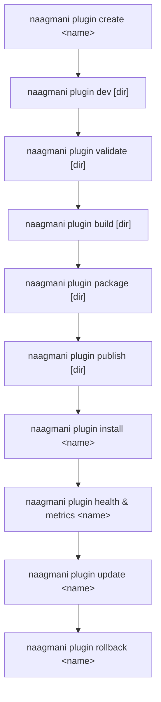

# Plugin Management via CLI

Manage the complete end-to-end lifecycle of custom HDK plugins using the `naagmani plugin` command suite.

---

## Plugin Command Lifecycle



---

## Command Reference

### 1. `naagmani plugin create <name>`
Scaffolds a new plugin project with canonical structure, manifest (`plugin.json`), entry point, and test harness.

```bash
naagmani plugin create email-guardrail --language go
# Options:
#   --language go|node|python  (Required: target HDK runtime language)
```

Generated directory layout:
```text
email-guardrail/
├── plugin.json       # Manifest declaring api_version: "v1", hooks, capabilities
├── main.go           # HDK entry point (or index.ts / main.py)
├── go.mod            # Dependencies referencing HDK
└── plugin_test.go    # Unit tests with HDK test runner
```

---

### 2. `naagmani plugin validate [dir]`
Performs static analysis and protocol schema validation on `plugin.json`.

```bash
naagmani plugin validate .
```

**Checks Performed:**
- `api_version` must equal `"v1"`.
- `name` must be lowercase alphanumeric with hyphens (no spaces or uppercase).
- `version` must be valid SemVer 2.0 (e.g. `1.0.0`).
- Declared `hooks` must match canonical hook names: `request.before`, `request.after`, `provider.before`, `provider.after`, `response.before`, `response.after`.
- Runtime command executable check.
- Validates permissions against core capability whitelist.

Exit code: `0` on success, `3` (`ExitValError`) on schema or protocol violation.

---

### 3. `naagmani plugin dev [dir]`
Runs the plugin locally in development mode, linking it to the local running Naagmani OS gateway for hot-reload testing.

```bash
naagmani plugin dev .
```

**Behavior:**
- Runs pre-flight verification on local runtimes (`go`, `node`, `python3`).
- Spawns the plugin process and executes standard `plugin.register` and `plugin.health` handshakes over stdio.
- Links the plugin into the local gateway's dynamic plugin registry (`~/.naagmani/dev-plugins.json`).
- Streams plugin `stderr` diagnostic logs directly to your terminal.

---

### 4. `naagmani plugin build [dir]`
Compiles or prepares the plugin for the target OS architecture and computes the canonical SHA-256 binary digest.

```bash
naagmani plugin build .
```

---

### 5. `naagmani plugin package [dir]`
Packages the plugin into a distributable, immutable `.tar.gz` bundle with SHA-256 checksum and manifest metadata.

```bash
naagmani plugin package .
# Output:
# Packaging plugin 'email-guardrail' v1.0.0...
# Generated archive: dist/email-guardrail-v1.0.0.tar.gz
# SHA-256 Digest: 9f86d081884c7d659a2feaa0c55ad015a3bf4f1b2b0b822cd15d6c15b0f00a08
```

---

### 6. `naagmani plugin publish [dir]`
Uploads and registers the packaged plugin version to Naagmani Cloud.

```bash
naagmani plugin publish . --visibility organization
# Options:
#   --visibility organization|public  (Default: organization)
#   --cloud-url <url>                 (Overrides NAAGMANI_CLOUD_URL)
```

> [!NOTE]
> Public marketplace distribution (`--visibility public`) requires Stage 3E hardware-backed publisher certification. Private organization publishing (`--visibility organization`) is active immediately for your team.

---

### 7. `naagmani plugin install <name>`
Installs or binds a published plugin into your active project and target environment.

```bash
naagmani plugin install email-guardrail --version "1.0.0" --env "production"
# Flags:
#   --version <semver>   (Optional: defaults to latest certified release)
#   --env <tier>         ("test" or "production", defaults to active environment)
#   --project-id <id>    (Overrides active project context)
```

---

### 8. `naagmani plugin list` / `versions`
Lists all registered plugins or shows release history for a specific plugin.

```bash
naagmani plugin list
naagmani plugin versions email-guardrail
```

---

### 9. `naagmani plugin update <name>`
Updates the installed plugin version in the target project environment.

```bash
naagmani plugin update email-guardrail --version "1.1.0" --env "production"
```

---

### 10. `naagmani plugin rollback <name>`
Immediately rolls back an installed plugin to its previous known-good version.

```bash
naagmani plugin rollback email-guardrail --env "production"
```

---

### 11. `naagmani plugin info <name>`
Displays detailed manifest metadata, declared hooks, required permissions, and author information.

```bash
naagmani plugin info email-guardrail
```

---

### 12. `naagmani plugin health <name>`
Executes a live health check on the running plugin worker process.

```bash
naagmani plugin health email-guardrail
# Output:
# Status: HEALTHY
# Worker PID: 48122
# Memory RSS: 24.5 MB
# Uptime: 4h 12m
# Protocol: naagmani.plugin/v1
```

---

### 13. `naagmani plugin metrics <name>`
Fetches invocation counts, latency percentiles (p50, p95, p99), block counts, and error rates.

```bash
naagmani plugin metrics email-guardrail
```

---

## Exit Codes for CI/CD

| Code | Constant | Meaning |
|---|---|---|
| `0` | `ExitSuccess` | Command succeeded. |
| `1` | `ExitInvalidArg` | Missing required argument, unrecognized flag, or bad directory. |
| `2` | `ExitAuthError` | Unauthorized; login expired or missing API key. |
| `3` | `ExitValError` | Manifest validation failed, protocol mismatch, or unapproved hook. |
| `4` | `ExitNetError` | Cloud API or Gateway unreachable. |

---

## Related Documentation

- [HDK Wire Protocol Specification](file:///e:/project/naagmani-project/naagmani-docs/docs/build/hdks/protocol.md)
- [HDK Plugin Manifest](file:///e:/project/naagmani-project/naagmani-docs/docs/build/hdks/manifest.md)
- [Building Custom Plugins](file:///e:/project/naagmani-project/naagmani-docs/docs/build/hdks/development.md)
- [CLI Command Reference](file:///e:/project/naagmani-project/naagmani-docs/docs/build/cli/commands.md)

