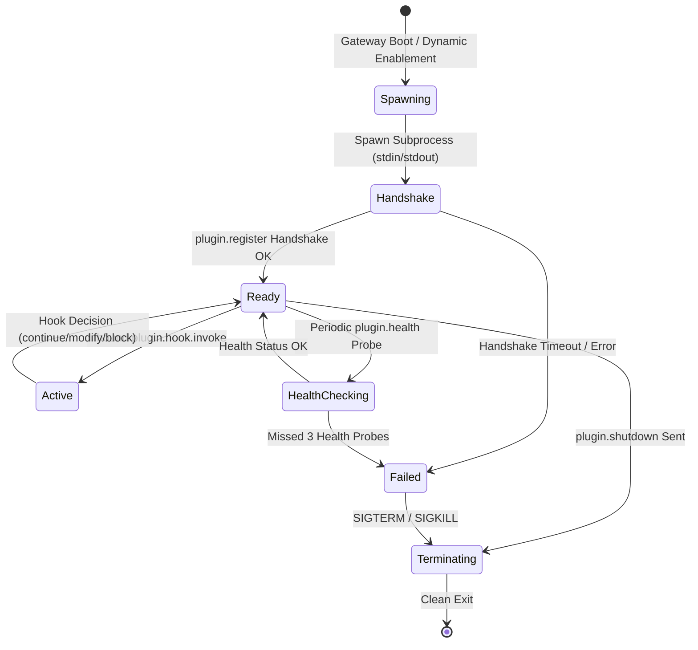
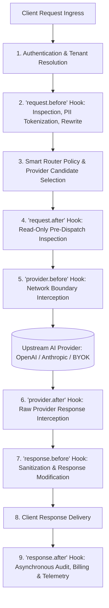

# Plugin Lifecycle & Execution Hooks

This document details the complete operational lifecycle of a Naagmani plugin worker process and the execution pipeline governing request and response interception.

---

## Subprocess Lifecycle

Naagmani OS supervises each plugin worker process as an isolated, sandboxed child process:

1. **Spawning**: When Naagmani OS initializes (or when a plugin is dynamically enabled for an environment), the OS launches the executable command defined in `runtime.command`.
2. **Handshake (`plugin.register`)**: The OS immediately sends a `plugin.register` request with initial tenant configuration and permission parameters. The plugin must respond within 3000ms with its declared capabilities.
3. **Execution (`plugin.hook.invoke`)**: Inbound inference requests pass through the hook pipeline. The OS serializes the request context and dispatches it to the plugin's `stdin`.
4. **Health Probing (`plugin.health`)**: The OS periodically validates process liveness. If a plugin fails to reply, the OS restarts the worker according to its supervisor backoff policy.
5. **Termination (`plugin.shutdown`)**: Before stopping, the OS issues `plugin.shutdown` with a grace period (default: 3000ms) allowing the plugin to flush buffers, close external connections, and exit cleanly.

---

## Canonical Hook Pipeline

Naagmani OS processes inference requests through a sequential, deterministic pipeline:

---

## Hook Descriptions & Capabilities

| Hook | Type | Mutating? | Description |
|---|---|---|---|
| **`request.before`** | Synchronous | **Yes** | Executes immediately after request authentication. Can inspect prompt messages, mutate parameters (`model`, `messages`, `temperature`), or block requests (`HTTP 403`). Used by Privacy Shield and guardrails. |
| **`request.after`** | Synchronous | No | Read-only hook dispatched immediately before smart router execution. Used for logging pre-routing request state. |
| **`provider.before`** | Synchronous | **Yes** | Executes at the provider network boundary before dispatching the HTTP call to the external model provider. |
| **`provider.after`** | Synchronous | **Yes** | Executes immediately after receiving the response from the model provider before parsing choices. |
| **`response.before`** | Synchronous | **Yes** | Executes before returning the response to the client. Can redact sensitive output tokens, watermark text, or block responses violating safety policies. |
| **`response.after`** | **Asynchronous** | No | Dispatched in the background after the response is delivered to the client. Ideal for metrics collection, token accounting, and compliance audit logging without adding client latency. |

---

## Failure Policies: Fail-Close vs. Fail-Open

Each plugin declares its `failure_policy` in `plugin.json`:

- **`fail_close` (Default & Mandatory for Security)**:
  - If the plugin panics, times out, or returns an unhandled error, the request is immediately aborted with HTTP 502/503.
  - Required for security guardrails, PII filters, and compliance checkers.
  - Guarantees sensitive plaintext is NEVER leaked downstream.
- **`fail_open` (Optional for Non-Critical Analytics)**:
  - If the plugin encounters an error or timeout, Naagmani OS logs a diagnostic warning and allows the request to continue downstream.
  - Suitable for non-critical analytics, optional telemetry, or external webhooks.
