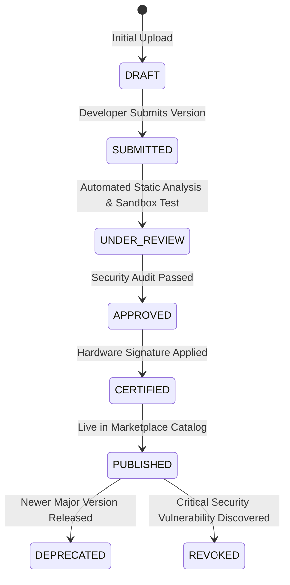

# Packaging & Publishing Plugins

This guide explains how to package a completed Naagmani plugin into an immutable release bundle, compute integrity checksums, apply publisher signatures, and publish to the Naagmani Marketplace.

---

## 1. Package Structure Requirements

When `naagmani plugin package` builds a release, the output archive must adhere to the canonical structure:

```text
my-plugin-1.0.0-linux-amd64.tar.gz
├── plugin.json         # Root manifest with api_version: "v1"
├── bin/
│   └── my-plugin       # Target executable binary
├── config/             # Optional default configuration files
└── README.md           # Markdown documentation displayed in Marketplace
```

To build and package:
```bash
naagmani plugin package .
```

The CLI executes:
1. Compilation for target OS and architecture (e.g. `linux/amd64`, `linux/arm64`).
2. Gzip compression into `.tar.gz`.
3. Deterministic SHA-256 calculation output to `.tar.gz.sha256`.

---

## 2. Release Integrity & Code Signing

In production, Naagmani OS enforces cryptographic package verification:
- **Checksum Verification**: Every download is verified against the publisher's registered SHA-256 digest before extraction.
- **Publisher Signature**: Packages must include an Ed25519 cryptographic signature generated by the publisher's authorized key or Cloud build service.
- **Trust Store Validation**: The OS matches the signature against trusted roots in its installation trust store (`internal/plugin/artifact/trust.go`).

> [!NOTE]
> **Stage 3E Status Notice**: Formal public marketplace publishing requiring hardware-backed official release signatures remains gated pending the official Stage 3E release-signing ceremony in Cloud KMS/HSM. Organization-private distribution within your own tenant is fully operational.

---

## 3. Publishing to Naagmani Cloud

Authenticate with the CLI:
```bash
naagmani login --cloud-url https://api.naagmani.ai
```

Publish your package version:

```bash
# Option A: Organization-Private (Internal to your company)
naagmani plugin publish . --visibility organization

# Option B: Public Marketplace (Pending review and certification)
naagmani plugin publish . --visibility public
```

---

## 4. Marketplace Certification Lifecycle

Published packages transition through formal certification stages:



1. **`DRAFT` / `SUBMITTED`**: Package uploaded to Cloud artifact repository.
2. **`UNDER_REVIEW`**: Automated static analysis scans permissions, verifies JSON-RPC 2.0 handshake compatibility, and checks for prohibited system calls.
3. **`APPROVED`**: Package verified by platform security checks.
4. **`PUBLISHED`**: Available for one-click installation in Developer Portal across permitted organizations and projects.
5. **`DEPRECATED` / `REVOKED`**: If a critical defect is identified, administrators or authors can revoke versions, prompting OS reconcilers to immediately freeze execution.

---

## Related Documentation

- [Marketplace Overview & Installation](/marketplace/overview)
- [Installation & Scope Isolation](/marketplace/installation)
- [CLI Command Reference](/build/cli/commands)
