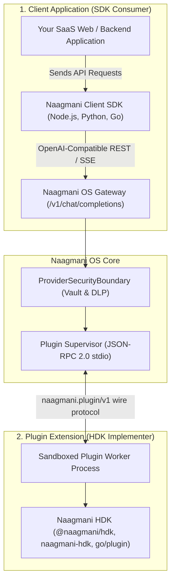

# SDK Overview

Official client libraries for integrating the Naagmani AI Operating System into your frontend, backend, and agentic applications.

---

## SDK vs HDK: Architecture Distinction

It is critical to understand the architectural distinction between the **SDK** (Client Application Integration) and the **HDK** (Gateway Capability Extension):



- **SDK (Software Development Kit)**: Use this in your client applications to **consume Naagmani APIs** (send chat prompts, stream tokens, query embeddings, pass tenant context, manage project resources).
- **HDK (Host Development Kit)**: Use this to **author native gateway plugins** that run as isolated worker processes communicating over standard I/O via JSON-RPC 2.0 to intercept requests and responses.

---

## Available Official Client SDKs

| Language / Runtime | Package Name | Minimum Version | Installation | Guide |
|---|---|---|---|---|
| **Node.js / TypeScript** | `@naagmani/sdk` | Node.js 18+ / TS 5+ | `npm install @naagmani/sdk` | [Node.js & TypeScript SDK](/build/sdks/node) |
| **Python** | `naagmani-sdk` | Python 3.9+ | `pip install naagmani-sdk` | [Python SDK](/build/sdks/python) |
| **Go** | `github.com/bhakha-services/naagmani-sdk-go` | Go 1.22+ | `go get github.com/bhakha-services/naagmani-sdk-go` | [Go SDK](/build/sdks/go) |

---

## Tenant Context & Headers

All SDK requests automatically forward required tenant context headers to ensure strict multi-tenant isolation and Privacy Shield enforcement in the gateway:

| Header | Description | Default / Source |
|---|---|---|
| `Authorization` | Bearer service token or API key (`nst_live_...` or `nak_...`) | Configured client credential |
| `X-Project-Id` | Target Naagmani project identifier (`proj_...`) | Client configuration or per-request override |
| `X-Environment` | Deployment tier: `test` or `production` | Bound to service token or explicitly passed |
| `X-Request-Id` | Unique UUIDv4 tracing request across Vault and plugins | Auto-generated by SDK |

---

## OpenAI SDK Drop-In Compatibility

Because Naagmani exposes an exact OpenAI-compatible REST API specification, you can also use official OpenAI SDKs directly by re-pointing the base URL to your Naagmani gateway:

```typescript
import OpenAI from 'openai';

// Direct drop-in with standard OpenAI client
const client = new OpenAI({
  apiKey: process.env.NAAGMANI_API_KEY,
  baseURL: 'http://localhost:8080/v1',
  defaultHeaders: {
    'X-Project-Id': process.env.NAAGMANI_PROJECT_ID,
    'X-Environment': 'production',
  },
});
```

---

## Next Steps

- [Node.js & TypeScript SDK](/build/sdks/node)
- [Python SDK](/build/sdks/python)
- [Go SDK](/build/sdks/go)
- [Building Custom Plugins with HDK](/build/hdks/overview)

