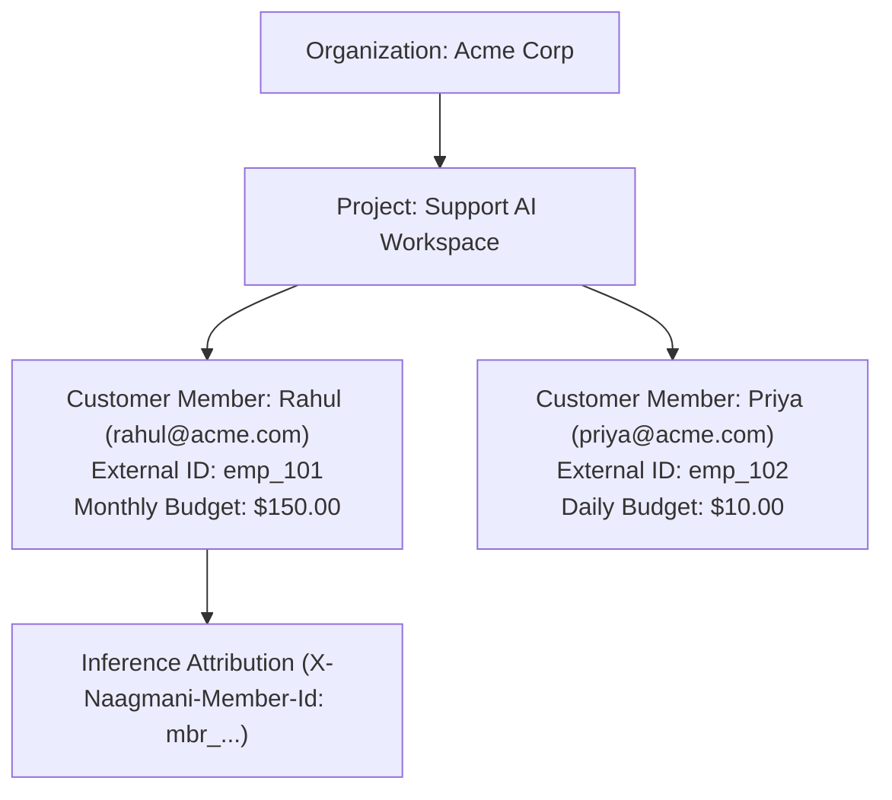

# Customer Members & Identity Scoping

A **Customer Member** represents an application end-user, employee, or automated consumer within a specific Project. Customer Members enable per-user FinOps budgets, token usage attribution, and fine-grained access governance.

---

## 1. Project-Scoped Architecture

In Naagmani's tenant hierarchy:
$$\text{Organization} \longrightarrow \text{Projects} \longrightarrow \text{Customer Members}$$

- **Strict Project Scoping**: Every customer member belongs to exactly one `project_id`. A customer member in *Project Alpha* has no visibility or standing in *Project Beta*.
- **Domain Separation**: Customer members are **application entities** (API consumers, end users). They do **not** have human login credentials to the Developer Portal. For human team members with portal access, see [Portal Users vs Customer Members](/concepts/portal-users-vs-customer-members).

---

## 2. External User IDs (`external_user_id`)

Customer Members bridge external customer identity systems (Active Directory, Okta, internal employee IDs) with Naagmani:

1. **Authoritative Persistence**: The `external_user_id` (e.g. `emp_101`, `usr_ext_prod_99182`) is stored as an authoritative, indexed column on the member entity.
2. **Zero Heuristic Parsing**: Identity is **never** derived from display names, emails, or API key strings (e.g. no parenthesis regex parsing).
3. **Project Uniqueness**: Within any given project, each `external_user_id` must be unique. The same external identifier may safely exist in separate projects without conflict.

---

## 3. Customer Member Budgets & FinOps

Each Customer Member can be assigned individual spending limits:

- **Daily Budget Cap (`daily_budget_amount`)**: Maximum USD allowed within a rolling 24-hour UTC day.
- **Monthly Budget Cap (`monthly_budget_amount`)**: Maximum USD allowed within the current calendar month.
- **Hierarchy Precedence**: A member's spending cap cannot exceed the parent Organization's budget. When a member's budget is exhausted, further inference requests attributed to that member are immediately rejected with `429 Too Many Requests` or `403 Forbidden` (`BUDGET_EXHAUSTED`).

---

## 4. Workload Attribution

AI inference executed by applications can attribute token usage and cost directly to a Customer Member:

- **Header Attribution**: Include `X-Naagmani-Member-Id: mbr_...` in requests authenticated with a Project Service Token.
- **User Tokens**: Child application tokens provisioned via `/v1/services/tokens` automatically bind `member_id` and `external_user_id`.
- **Usage Telemetry**: The member ID is recorded in `usage_events`, feeding real-time project analytics and audit logs.

---

## 5. Lifecycle Management

| Operation | Scope | Endpoint | Required Permission |
| :--- | :--- | :--- | :--- |
| **Create** | Project | `POST /v1/organizations/{orgID}/projects/{projectID}/members` | `members.create` / `members.write` |
| **List** | Project | `GET /v1/organizations/{orgID}/projects/{projectID}/members` | `members.read` |
| **Get** | Project | `GET /v1/organizations/{orgID}/projects/{projectID}/members/{memberID}` | `members.read` |
| **Update** | Project | `PATCH /v1/organizations/{orgID}/projects/{projectID}/members/{memberID}` | `members.write` |
| **Delete** | Project | `DELETE /v1/organizations/{orgID}/projects/{projectID}/members/{memberID}` | `members.write` |
| **Set Budget** | Project | `PUT /v1/organizations/{orgID}/projects/{projectID}/members/{memberID}/budget` | `members.write` |

---

## Next Steps

- [Portal Users vs Customer Members](/concepts/portal-users-vs-customer-members)
- [Customer Members API Reference](/api/customer-members)
- [Project Service Tokens](/concepts/project-service-tokens)
