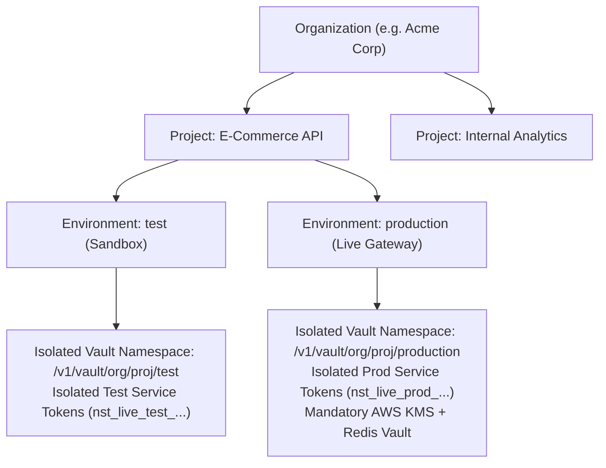

# Environments & Multi-Tenant Scope Model

Naagmani enforces a deterministic, hierarchical three-tier scope model: **Organization → Project → Environment**. 

Within every Project, environments are strictly segregated into two supported tiers: **Test** (`test`) and **Production** (`production`).



---

## The Scope Hierarchy

1. **Organization (`org_id`)**: The top-level billing, IAM, and enterprise compliance boundary. Organizations own user memberships, SSO configurations, and private plugin catalogs.
2. **Project (`project_id`)**: A discrete application, service, or repository workspace. Projects own model routing policies, spend quotas, rate limits, and capability bindings.
3. **Environment (`environment`)**: Exactly one of two operational tiers:
   - `test`: For local development, staging environments, and CI/CD test automation.
   - `production`: For live, customer-facing production traffic with mandatory Privacy Shield, KMS encryption, and audit logging.

---

## Cryptographic & Storage Isolation Guarantees

Environments are not merely database tags; they are cryptographically isolated across the entire Naagmani stack:

| Dimension | `test` Environment | `production` Environment |
|---|---|---|
| **Service Tokens** | Prefixed `nst_test_...` or tagged `test`. Rejection if presented to `production`. | Prefixed `nst_prod_...` or tagged `production`. Rejection if presented to `test`. |
| **AWS KMS Key Context** | Derived AAD contains `naagmani:environment: test`. | Derived AAD contains `naagmani:environment: production`. Cross-environment decryption is impossible. |
| **Redis Storage Namespace** | Key prefix `v1:vault:{org_id}:{proj_id}:test:{token}` | Key prefix `v1:vault:{org_id}:{proj_id}:production:{token}` |
| **Privacy Shield Invariant** | Configurable (mock KMS / in-memory permitted in local development). | **Mandatory & Fail-Closed**: Missing or invalid AWS KMS or Redis strictly prevents daemon boot. |
| **Plugin Execution** | Independent process instances with test secrets. | Independent process instances with production secrets; strict capability checks. |

---

## Cross-Environment Rejection Invariant

If a client attempts to present a token issued for the `test` environment against a `production` project endpoint or vice-versa:

```http
POST /v1/chat/completions HTTP/1.1
Host: gateway.internal.acme.com
Authorization: Bearer nst_test_abc123...
X-Environment: production

HTTP/1.1 403 Forbidden
Content-Type: application/json

{
  "error": {
    "code": "ENVIRONMENT_MISMATCH",
    "message": "Token was issued for 'test' environment but presented to 'production' endpoint. Cross-environment token substitution is strictly prohibited."
  }
}
```

---

## Managing Environments

### In the Developer Portal
- Use the environment selector at the top of the dashboard to toggle between **Test** and **Production**.
- All configuration changes, plugin settings, and API keys created while in **Test** mode remain strictly confined to the sandbox.

### In the CLI
- Configure default environment via `naagmani config set environment test`.
- Override per command with `--env test` or `--env production`.
- Set via `export NAAGMANI_ENVIRONMENT="production"` in deployment environments.

---

## Related Documentation

- [Project Service Tokens](file:///e:/project/naagmani-project/naagmani-docs/docs/developer-portal/projects/service-tokens.md)
- [Marketplace Installation & Scope Isolation](file:///e:/project/naagmani-project/naagmani-docs/docs/marketplace/installation.md)
- [Cryptographic Vault & Privacy Shield Architecture](file:///e:/project/naagmani-project/naagmani-docs/docs/security/data-protection.md)

