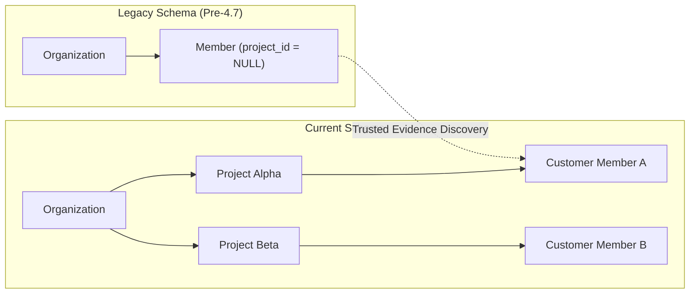

# Migration: Organization to Project-Scoped Customer Members

This guide details the migration strategy, data integrity guarantees, and reconciliation mechanisms for transitioning legacy organization-scoped Customer Members to project-scoped workspaces.

---

## 1. Migration Background

In earlier platform releases, Customer Members were associated directly with an Organization (`project_id IS NULL`). To support multi-tenant enterprise isolation, fine-grained project budgeting, and Project Service Token scoping, Customer Members are now canonically scoped to individual Projects (`project_id` foreign key).



---

## 2. Core Integrity & Safety Invariants

To eliminate data corruption or accidental cross-project disclosure during migration:

1. **Additive Schema Migration**: The `project_id` and `external_user_id` columns on the `members` table are additive and nullable. No table rewrites or locking migrations occur.
2. **Zero Guessing or Email Merging**: Historical records are **never** merged based solely on matching email addresses or display names.
3. **No Arbitrary Assignments**: If a legacy customer member cannot be linked to a project with 100% unambiguous cryptographic or historical evidence, they remain safely unassigned (`project_id IS NULL`).
4. **Historical Legacy Access**: Organization Owners and Admins can continue accessing unassigned legacy members via legacy routes (`/v1/organizations/{orgID}/members`).

---

## 3. Trusted OS Evidence Reconciliation

The platform provides a server-side reconciliation engine (`/members/reconcile`) that matches legacy members to projects based strictly on historical proof:

- **Cryptographic Key Evidence**: API keys provisioned by that member that are bound to a specific project.
- **Service Token Lineage**: Machine tokens with verified project attribution.
- **Audit Event History**: Unambiguous telemetry tying the member's activity to a project workspace.

### Running a Safe Dry-Run Audit:
```bash
curl -X POST "{{API_BASE_URL}}/v1/organizations/{orgID}/members/reconcile?dry_run=true" \
  -H "Authorization: Bearer <ADMIN_TOKEN>"
```

### Response Example:
```json
{
  "total_examined": 142,
  "reconciled": 118,
  "unresolved_ambiguous": 14,
  "unresolved_no_evidence": 10,
  "dry_run": true,
  "records": [
    {
      "member_id": "mbr_01J8K3M90A",
      "email": "rahul@acme.com",
      "resolved_project_id": "proj_support_prod",
      "confidence": "high",
      "reason": "Unambiguous historical API key association"
    },
    {
      "member_id": "mbr_01J8K3M90B",
      "email": "priya@acme.com",
      "resolved_project_id": "",
      "confidence": "ambiguous",
      "reason": "Conflicting historical associations across multiple projects; preserved as unassigned"
    }
  ]
}
```

---

## 4. Guarded Rollback

If a batch reconciliation requires reversal, administrators can execute a guarded rollback specifying the target member IDs or batch ID:

```bash
curl -X POST "{{API_BASE_URL}}/v1/organizations/{orgID}/members/reconcile/rollback" \
  -H "Authorization: Bearer <ADMIN_TOKEN>" \
  -H "Content-Type: application/json" \
  -d '{
    "member_ids": ["mbr_01J8K3M90A"]
  }'
```

This restores the member's `project_id` to `NULL` without impacting token secrets, budgets, or historical usage records.

---

## 5. API Key Compatibility

- **Existing Keys**: Historical API keys without `external_user_id` continue to function seamlessly.
- **Identity Fallback**: The runtime inspects `external_user_id`. If unset, it gracefully falls back to non-`mbr_` historical member identifiers.
- **Secret Preservation**: No key secrets, hashes, or identifiers are altered during or after migration.

---

## Next Steps

- [Customer Members Architecture](/docs/concepts/customer-members)
- [Customer Members API Reference](/docs/api/customer-members)
- [Project Service Tokens](/docs/concepts/project-service-tokens)
