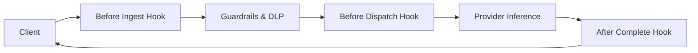

# Plugin System & Lifecycle

Naagmani's plugin engine allows developers to intercept, modify, and guard AI requests using an out-of-process, language-independent architecture (`naagmani.plugin/v1`).

---

## Key Capabilities

1. **Multi-Language HDKs**: Author plugins in **Go**, **TypeScript/Node.js**, or **Python**.
2. **Isolated Sandboxing**: Plugins run in isolated worker processes communicating over standard I/O via JSON-RPC 2.0 (`naagmani.plugin/v1`), ensuring custom code cannot crash the core gateway engine.
3. **Execution Hooks**:
   - `request.before`: Inspect incoming headers, validate custom tokens, verify rate limits.
   - `provider.before`: Mask sensitive PII/DLP data, inject system prompts, perform RAG vector retrieval.
   - `response.before`: Sanitize model responses, restore encrypted Privacy Shield tokens, trigger downstream webhooks.

---

## Next Steps

- Deep dive into plugin development: [Building Custom Plugins](file:///e:/project/naagmani-project/naagmani-docs/docs/build/hdks/development.md)
- Plugin manifest specification: [Plugin Manifest Schema](file:///e:/project/naagmani-project/naagmani-docs/docs/build/hdks/manifest.md)
- Wire Protocol Reference: [HDK Wire Protocol v1](file:///e:/project/naagmani-project/naagmani-docs/docs/build/hdks/protocol.md)

