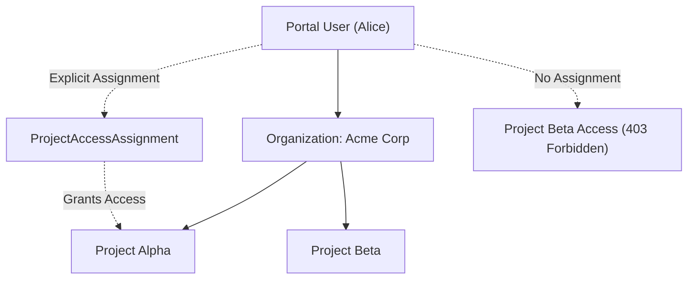

# Portal Users vs Customer Members

Naagmani maintains strict domain separation between **Portal Users** (human developers and administrators) and **Customer Members** (workload and end-user application identities).

---

## 1. Core Comparison Matrix

| Dimension | Portal Users | Customer Members |
| :--- | :--- | :--- |
| **Domain** | Human platform administrators and developers | End-users or consumers of the customer application (e.g. employee) |
| **Membership Scope** | Organization-wide (`organization_memberships`) | Project-scoped (`members` table, `project_id`) |
| **Authentication** | Session JWT / Password / SSO | Project Service Token / Scoped API Key / `X-Naagmani-Member-Id` |
| **Identity Source** | Verified Work Email | Authoritative External User ID (`external_user_id`) |
| **FinOps / Budget** | Seat capacity (`max_members` licensing) | Monetary budget caps (`daily_budget_amount`, `monthly_budget_amount`) |
| **Project Access** | Controlled via `ProjectAccessAssignment` | Inherent to their owning `project_id` |
| **Management UI** | Developer Portal: `/users` | Developer Portal: `/projects/[projectId]/members` |
| **API Endpoints** | `/v1/organizations/{orgID}/users` | `/v1/organizations/{orgID}/projects/{projectID}/members` |

---

## 2. ProjectAccessAssignment for Portal Users

While Customer Members naturally reside inside a project, human **Portal Users** belong to the Organization and must be granted explicit access to projects:



### Authorization Rules:
1. **Built-in Owners & Admins**: Users holding the built-in Organization `Owner` or `Admin` role automatically possess organization-wide access to all project workspaces across all installations.
2. **Standard Members & Custom Roles**: Standard Portal Users require an explicit `ProjectAccessAssignment` record (`project_access_assignments`). Without this assignment:
   - Navigating to `/projects` lists only explicitly assigned projects.
   - Accessing an unassigned project URL returns `403 Forbidden`.
   - Zero-assignment state fails closed without revealing unauthorized project names or metadata.
3. **Inherited Permissions**: Once assigned to a project workspace, a Portal User's effective operational permissions inside that workspace are authoritative and inherited from their Organization Role.

---

## 3. Assigning Portal Users to Projects

### In Developer Portal:
1. Navigate to the project workspace: **Projects** -> Select Project -> **Access & Authorization** (`/projects/[projectId]/access`).
2. Click **Assign Portal User**.
3. Select the team member from the organization directory and confirm.

### Via REST API:
```bash
curl -X POST "{{API_BASE_URL}}/v1/organizations/{orgID}/projects/{projectID}/users" \
  -H "Authorization: Bearer <PORTAL_USER_JWT>" \
  -H "Content-Type: application/json" \
  -d '{
    "user_id": "usr_01J8K3M90A"
  }'
```

---

## Next Steps

- [Customer Members Architecture](/concepts/customer-members)
- [Project Access API Reference](/api/project-access)
- [Project Service Tokens](/concepts/project-service-tokens)
