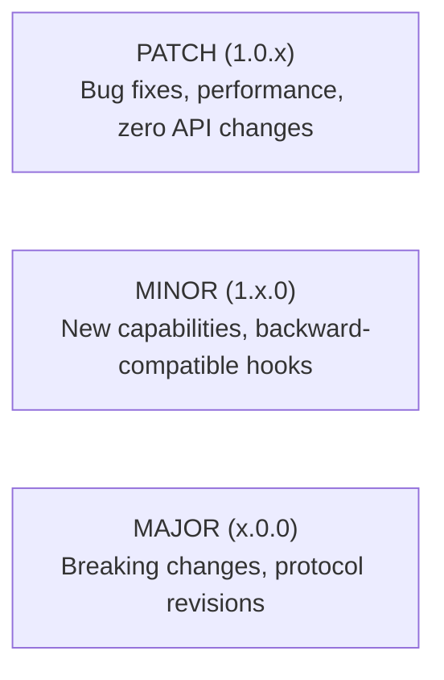

# Versioning, Compatibility & Change Management

Guidelines and policies governing public API versioning, plugin protocol compatibility, release cadences, and documentation maintenance across the Naagmani ecosystem.

---

## Documentation Ownership Principles

1. **Public Documentation Single Source of Truth**:
   - `naagmani-docs` is the primary, authoritative public developer documentation repository.
   - All guides, quickstarts, HDK/SDK references, CLI manuals, and marketplace tutorials are published from `naagmani-docs`.
2. **Internal Architecture & Security Retention**:
   - Deep cryptographic analysis, KMS capacity models, internal memory layout limits, and ADRs (Architecture Decision Records) remain in their owning engineering repositories (e.g. `naagmani-os/docs/architecture.md`, `internal/vault/`).
   - Public documentation links to high-level architecture concepts without exposing operational credentials or private internal infrastructure.
3. **No Cross-Repo Content Duplication**:
   - Public code samples and quickstarts point back to canonical guides in `naagmani-docs`.

---

## Semantic Versioning & API Compatibility

Naagmani follows **Semantic Versioning 2.0.0** (`MAJOR.MINOR.PATCH`):

| Layer | Current Version | Stability Guarantee | Deprecation Window |
|---|---|---|---|
| **Public REST API** | `/v1` | Backward-compatible across all 1.x releases. | Minimum 12 months notice before major deprecation. |
| **Plugin Wire Protocol** | `naagmani.plugin/v1` | Strict JSON-RPC 2.0 frame compatibility. | Backward-compatible across minor gateway updates. |
| **HDK Libraries** | `1.0.0` | Method signatures and hook interfaces preserved. | 2 minor releases with compile-time warnings. |
| **Client SDKs** | `1.0.0` | OpenAI REST client drop-in compatibility maintained. | 2 minor releases. |
| **CLI Tooling** | `1.0.0` | Deterministic exit codes (`0` to `4`) and flags preserved. | Deprecation warning printed to `stderr` for 1 release. |

---

## Plugin API Compatibility & Migration

- **Protocol Version Invariant**: Every plugin manifest declares `api_version: "v1"`. The gateway rejects plugins declaring unknown protocol versions during initial registration handshake (`ExitValError`).
- **Capability Additions**: New hooks or capability permissions added in minor releases are strictly optional. Plugins compiled against older HDK versions continue running without modification.
- **Breaking-Change Migration**: If a major breaking change is required:
  1. A formal Architecture Decision Record is published.
  2. A dedicated Migration Guide is authored in `naagmani-docs/docs/concepts/`.
  3. The gateway supports dual-protocol compatibility during the transition window.

---

## Documentation Quality Gate for Pull Requests

To ensure documentation never diverges from active runtime code, all repository Pull Requests must adhere to the **Doc-Sync Policy**:

1. **CLI Commands & Flags**: Any change or addition to flags in `naagmani-cli` must include an update to `naagmani-docs/docs/build/cli/commands.md` and `plugins.md`.
2. **SDK Signatures**: Any modification to client parameters or response objects in Go, Node.js, or Python SDKs must include verified code snippets in `docs/build/sdks/`.
3. **HDK Interfaces**: Any change to hook signatures or wire protocol frames must be reflected in `docs/build/hdks/manifest.md` and `protocol.md`.
4. **Automated CI Build**: Pull Requests in `naagmani-docs` must pass `npm run build` with zero broken links or markdown compilation errors.

---

## Related Documentation

- [HDK Wire Protocol Specification](/build/hdks/protocol)
- [Marketplace Publishing & Lifecycle](/marketplace/publishing)
- [CLI Command Reference](/build/cli/commands)
