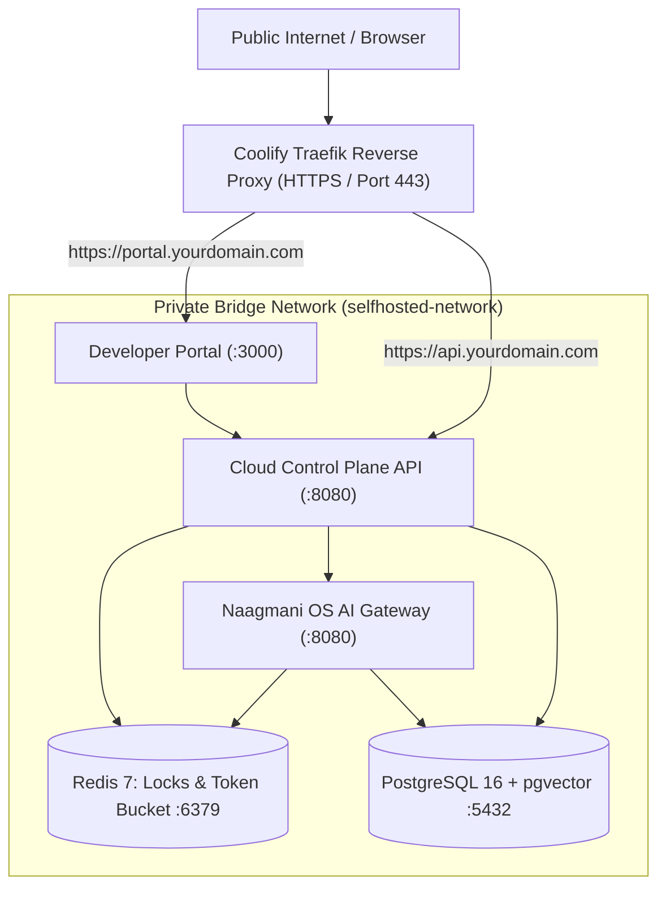

# Coolify & PaaS Deployment Guide

Deploy the complete **Naagmani AI Operating System** onto [Coolify](https://coolify.io) or any Docker Compose-based self-hosted PaaS platform.

This guide walks you through setting up Naagmani as a managed **Docker Compose Stack** in Coolify, leveraging automatic Traefik SSL/TLS termination, automated health probes, and persistent volumes without cloning any source code repositories.

---

## Architecture Overview

When deployed in Coolify, Naagmani runs as a unified 5-service stack behind Coolify's built-in **Traefik** reverse proxy:



### Services & Network Exposure Summary

| Service | Internal Port | Coolify Exposure | Public Domain (Example) | Health Check |
|---|---|---|---|---|
| **`developer`** | `3000` | **Public (HTTPS)** | `https://portal.yourdomain.com` | `http://127.0.0.1:3000` |
| **`cloud`** | `8080` | **Public (HTTPS)** | `https://api.yourdomain.com` | `http://127.0.0.1:8080/health` |
| **`os`** | `8080` | Internal Only (or Public) | Accessible internally at `http://os:8080` | `http://127.0.0.1:8080/v1/health` |
| **`postgres`** | `5432` | **Private Only** | Not exposed to internet | `pg_isready` (Dual DB init) |
| **`redis`** | `6379` | **Private Only** | Not exposed to internet | `redis-cli ping` |

---

## Step-by-Step Coolify Deployment

### Step 1: Create a New Service in Coolify

1. Open your **Coolify Dashboard**.
2. Navigate to **Projects** → Select your Project and Environment (e.g. `production`).
3. Click **+ New Resource**.
4. Under the **Services** section, select **Docker Compose**.
5. Name your stack: `naagmani-stack`.

---

### Step 2: Paste the Docker Compose Specification

In the Coolify **Docker Compose** editor, paste the following production configuration:

```yaml
name: naagmani-coolify

services:
  postgres:
    image: pgvector/pgvector:pg16
    restart: unless-stopped
    environment:
      POSTGRES_USER: ${POSTGRES_USER:-naagmani}
      POSTGRES_PASSWORD: ${POSTGRES_PASSWORD:-naagmanipassword}
      POSTGRES_DB: ${POSTGRES_DB:-${POSTGRES_DB_CLOUD:-naagmani_selfhosted}}
    volumes:
      - selfhosted-postgres-data:/var/lib/postgresql/data
    healthcheck:
      test: ["CMD-SHELL", "pg_isready -U ${POSTGRES_USER:-naagmani} -d ${POSTGRES_DB:-${POSTGRES_DB_CLOUD:-naagmani_selfhosted}} && (psql -U ${POSTGRES_USER:-naagmani} -d ${POSTGRES_DB:-${POSTGRES_DB_CLOUD:-naagmani_selfhosted}} -tc \"SELECT 1 FROM pg_database WHERE datname = 'naagmani'\" | grep -q 1 || psql -U ${POSTGRES_USER:-naagmani} -d ${POSTGRES_DB:-${POSTGRES_DB_CLOUD:-naagmani_selfhosted}} -c \"CREATE DATABASE naagmani;\")"]
      interval: 5s
      timeout: 5s
      retries: 5
      start_period: 10s
    deploy:
      resources:
        limits:
          cpus: '2.0'
          memory: 2048M
        reservations:
          cpus: '0.5'
          memory: 512M
    networks:
      - selfhosted-network

  redis:
    image: redis:7-alpine
    restart: unless-stopped
    healthcheck:
      test: ["CMD", "redis-cli", "ping"]
      interval: 5s
      timeout: 5s
      retries: 5
      start_period: 5s
    deploy:
      resources:
        limits:
          cpus: '1.0'
          memory: 512M
        reservations:
          cpus: '0.2'
          memory: 128M
    networks:
      - selfhosted-network

  os:
    image: ghcr.io/bhakha-services/naagmani-os:${NAAGMANI_VERSION:-latest}
    restart: unless-stopped
    environment:
      NAAGMANI_ENV: ${NAAGMANI_ENV:-production}
      NAAGMANI_SERVER_HOST: 0.0.0.0
      NAAGMANI_SERVER_PORT: 8080
      NAAGMANI_PORT: 8080
      DATABASE_URL: postgres://${POSTGRES_USER:-naagmani}:${POSTGRES_PASSWORD:-naagmanipassword}@postgres:5432/${POSTGRES_DB_OS:-naagmani}?sslmode=disable
      NAAGMANI_REDIS_URL: redis://redis:6379/1
      REDIS_URL: redis://redis:6379/1
      NAAGMANI_LOG_LEVEL: ${NAAGMANI_LOG_LEVEL:-${LOG_LEVEL:-info}}
      NAAGMANI_LOG_FORMAT: json
      NAAGMANI_ENCRYPTION_KEY: ${NAAGMANI_ENCRYPTION_KEY}
      NAAGMANI_DATA_DIR: /home/naagmani/.naagmani
    volumes:
      - selfhosted-os-data:/home/naagmani/.naagmani
    expose:
      - "8080"
    healthcheck:
      test: ["CMD-SHELL", "wget -q -O - http://127.0.0.1:8080/v1/health > /dev/null || exit 1"]
      interval: 5s
      timeout: 5s
      retries: 5
      start_period: 15s
    depends_on:
      postgres:
        condition: service_healthy
    deploy:
      resources:
        limits:
          cpus: '2.0'
          memory: 2048M
        reservations:
          cpus: '0.5'
          memory: 512M
    networks:
      - selfhosted-network
      - coolify

  cloud:
    image: ghcr.io/bhakha-services/naagmani-cloud:${NAAGMANI_VERSION:-latest}
    restart: unless-stopped
    environment:
      APP_ENV: ${NAAGMANI_ENV:-production}
      NAAGMANI_ENV: ${NAAGMANI_ENV:-production}
      PORT: 8080
      NAAGMANI_CLOUD_PORT: 8080
      NAAGMANI_CLOUD_HOST: 0.0.0.0
      DATABASE_URL: postgres://${POSTGRES_USER:-naagmani}:${POSTGRES_PASSWORD:-naagmanipassword}@postgres:5432/${POSTGRES_DB:-${POSTGRES_DB_CLOUD:-naagmani_selfhosted}}?sslmode=disable
      REDIS_URL: redis://redis:6379/0
      NAAGMANI_REDIS_URL: redis://redis:6379/0
      JWT_SECRET: ${JWT_SECRET}
      NAAGMANI_SESSION_SECRET: ${NAAGMANI_SESSION_SECRET}
      COMMERCIAL_BILLING_ENABLED: "false"
      COMMERCIAL_LICENSE_ENABLED: "false"
      NAAGMANI_ADMIN_EMAIL: ${NAAGMANI_ADMIN_EMAIL:-admin@selfhosted.local}
      NAAGMANI_ADMIN_PASSWORD: ${NAAGMANI_ADMIN_PASSWORD}
      PORTAL_BASE_URL: ${PORTAL_BASE_URL}
      CLOUD_BASE_URL: ${CLOUD_BASE_URL}
      NAAGMANI_CORS_ALLOWED_ORIGINS: ${PORTAL_BASE_URL},${CLOUD_BASE_URL}
      NAAGMANI_OS_URL: http://os:8080
      LOG_LEVEL: ${LOG_LEVEL:-info}
    expose:
      - "8080"
    healthcheck:
      test: ["CMD-SHELL", "wget -q -O - http://127.0.0.1:8080/health > /dev/null || exit 1"]
      interval: 5s
      timeout: 5s
      retries: 5
      start_period: 15s
    depends_on:
      postgres:
        condition: service_healthy
      redis:
        condition: service_healthy
    deploy:
      resources:
        limits:
          cpus: '2.0'
          memory: 2048M
        reservations:
          cpus: '0.5'
          memory: 512M
    networks:
      - selfhosted-network
      - coolify

  developer:
    image: ghcr.io/bhakha-services/naagmani-developer:${NAAGMANI_VERSION:-latest}
    restart: unless-stopped
    environment:
      NODE_ENV: production
      PORT: 3000
      HOSTNAME: "0.0.0.0"
      PORTAL_BASE_URL: ${PORTAL_BASE_URL}
      NEXT_PUBLIC_CLOUD_API_URL: ${CLOUD_BASE_URL}
      NEXT_PUBLIC_API_BASE_URL: ${CLOUD_BASE_URL}
      NEXT_PUBLIC_OS_API_URL: ${OS_BASE_URL:-http://os:8080}
    expose:
      - "3000"
    healthcheck:
      test: ["CMD-SHELL", "wget -q -O - http://127.0.0.1:3000 > /dev/null || exit 1"]
      interval: 10s
      timeout: 5s
      retries: 5
      start_period: 20s
    depends_on:
      cloud:
        condition: service_healthy
    deploy:
      resources:
        limits:
          cpus: '2.0'
          memory: 1024M
        reservations:
          cpus: '0.2'
          memory: 256M
    networks:
      - selfhosted-network
      - coolify

networks:
  selfhosted-network:
    driver: bridge
  coolify:
    external: true

volumes:
  selfhosted-postgres-data:
  selfhosted-os-data:
```

---

### Step 3: Configure Domains in Coolify

In the Coolify Service UI, configure your public domains:

1. **Developer Portal (`developer`)**:
   - Under the `developer` service configuration, find the **Domains** field.
   - Enter your public portal URL: `https://portal.yourdomain.com`
   - Target Port: `3000`
2. **Cloud Control Plane (`cloud`)**:
   - Under the `cloud` service configuration, find the **Domains** field.
   - Enter your public API URL: `https://api.yourdomain.com`
   - Target Port: `8080`
3. Coolify will automatically provision Let's Encrypt SSL certificates for both domains through Traefik.

---

### Step 4: Configure Environment Variables

Navigate to the **Environment Variables** tab of your Coolify service, and configure the following:

```ini
# --- Release Tag ---
NAAGMANI_VERSION=latest

# --- Public Endpoints ---
PORTAL_BASE_URL=https://portal.yourdomain.com
CLOUD_BASE_URL=https://api.yourdomain.com

# --- Administrator Credentials ---
NAAGMANI_ADMIN_EMAIL=admin@yourdomain.com
NAAGMANI_ADMIN_PASSWORD=YourStrongPasswordHere123!

# --- Security Secrets (32-byte hex keys) ---
# Generate with: openssl rand -hex 32
NAAGMANI_ENCRYPTION_KEY=f6a9b8c7d6e5f4a3b2c1d0e9f8a7b6c5d4e3f2a1b0c9d8e7f6a5b4c3d2e1f0a9
JWT_SECRET=a1b2c3d4e5f6a7b8c9d0e1f2a3b4c5d6e7f8a9b0c1d2e3f4a5b6c7d8e9f0a1b2
NAAGMANI_SESSION_SECRET=a1b2c3d4e5f6a7b8c9d0e1f2a3b4c5d6e7f8a9b0c1d2e3f4a5b6c7d8e9f0a1b2

# --- Database Credentials ---
POSTGRES_USER=naagmani
POSTGRES_PASSWORD=YourSecurePostgresPassword123!
```

> [!TIP]
> You can generate random 32-byte hex strings directly using Coolify's built-in secret generator or on your terminal with:
> ```bash
> openssl rand -hex 32
> ```

---

### Step 5: Deploy the Stack

1. Click **Deploy** in the top-right corner of the Coolify interface.
2. Coolify will:
   - Connect the stack to the `coolify` external Traefik network.
   - Pull multi-architecture container images from GHCR (`ghcr.io/bhakha-services/*`).
   - Start PostgreSQL and automatically create both the `naagmani` (Data Plane) and `naagmani_selfhosted` (Control Plane) databases.
   - Boot Redis, Naagmani OS Gateway, Cloud API, and the Developer Portal.
   - Run dependency-aware health checks until all services are healthy.
   - Bind SSL certificates via Traefik.
3. Once deployment status turns green (**Healthy**), navigate to `https://portal.yourdomain.com` and log in with your configured admin credentials.

---

## Upgrades & Maintenance in Coolify

### Performing Zero-Downtime Updates
1. In your Coolify service, navigate to **Environment Variables**.
2. Change `NAAGMANI_VERSION` to the new release tag (e.g. `v1.0.1` or keep `latest`).
3. Click **Redeploy**.
4. Coolify will pull the updated container images and perform a rolling replacement while preserving database and vault volumes.

### Database Backups
Because PostgreSQL uses the named volume `selfhosted-postgres-data`, you can:
- Use Coolify's automated volume backup feature to take scheduled S3 snapshots.
- Or trigger manual database dumps from the Coolify Terminal tab.

---

## Related Documentation

- [1-Command Automated Installation Guide](/deploy/installation)
- [Docker Compose Deployment Guide](/deploy/docker-compose)
- [Air-Gapped & Offline Setup](/deploy/offline)
