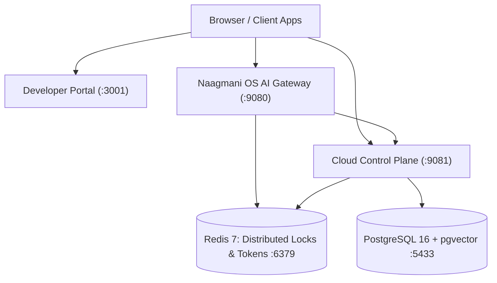

# Docker Compose Deployment

Deploy the complete, single-node **Naagmani AI Operating System** stack using Docker and Docker Compose.

---

## Architecture Overview

A production Docker Compose deployment includes 5 core services running in an isolated container network:



### Port Mapping & Services Summary

| Service | Host Port | Internal Port | Health Check | Description |
|---|---|---|---|---|
| **Developer Portal** | `3001` | `3000` | HTTP `GET /` | Next.js Developer & Admin Workspace UI |
| **Naagmani OS** | `9080` | `8080` | HTTP `GET /v1/health` | High-throughput AI proxy, BYOK vault & plugins |
| **Cloud Control Plane** | `9081` | `8080` | HTTP `GET /health` | Authentication, RBAC, organizations, and metering |
| **PostgreSQL 16** | `5433` | `5432` | `pg_isready` | Relational & vector store (Data Plane & Control Plane DBs) |
| **Redis 7** | `6379` | `6379` | `redis-cli ping` | In-memory token bucket rate limiting & atomic locks |

---

## Option 1: 1-Command Automated Installer (Recommended)

The fastest and most reliable way to deploy is using the official 1-command installer script. It validates prerequisites, generates cryptographically strong keys, sets up database schemas, pulls official multi-arch images from GHCR, and starts the stack:

### Linux / macOS

```bash
# Using curl:
curl -fsSL https://naagmani.com/install.sh | bash

# Or using wget:
wget -qO- https://naagmani.com/install.sh | bash
```

### Windows (PowerShell)

Open PowerShell as Administrator (or standard user with Docker Desktop running):

```powershell
iwr -useb https://naagmani.com/install.ps1 | iex
```

Or using the short alias `irm`:

```powershell
irm https://naagmani.com/install.ps1 | iex
```

---

## Option 2: Standalone GHCR Docker Compose (Zero Code Cloning)

If you prefer to inspect and manage the Docker Compose file directly without using an automated installer script:

### Step 1: Create Directory and Download Compose Stack

```bash
# 1. Create deployment directory
mkdir -p ~/naagmani && cd ~/naagmani

# 2. Download the standalone GHCR compose definition
curl -fsSL https://naagmani.com/docker-compose.yml -o docker-compose.yml
```

### Step 2: Initialize Databases Script

```bash
cat << 'EOF' > init-databases.sql
SELECT 'CREATE DATABASE naagmani'
WHERE NOT EXISTS (SELECT FROM pg_database WHERE datname = 'naagmani')\gexec
EOF
```

### Step 3: (Optional) Copy-Paste `docker-compose.yml` Directly

If you prefer not to download the file via `curl`, you can directly create `docker-compose.yml` with the following content:

```yaml
name: naagmani-self-hosted

services:
  postgres:
    image: pgvector/pgvector:pg16
    container_name: naagmani-selfhosted-postgres
    restart: unless-stopped
    ports:
      - "${POSTGRES_PORT:-5433}:5432"
    environment:
      POSTGRES_USER: ${POSTGRES_USER:-naagmani}
      POSTGRES_PASSWORD: ${POSTGRES_PASSWORD:-naagmanipassword}
      POSTGRES_DB: ${POSTGRES_DB:-naagmani_selfhosted}
    volumes:
      - selfhosted-postgres-data:/var/lib/postgresql/data
      - ./init-databases.sql:/docker-entrypoint-initdb.d/init-databases.sql:ro
    healthcheck:
      test: ["CMD-SHELL", "pg_isready -U ${POSTGRES_USER:-naagmani} -d ${POSTGRES_DB:-naagmani_selfhosted}"]
      interval: 5s
      timeout: 5s
      retries: 5
    networks:
      - selfhosted-network

  redis:
    image: redis:7-alpine
    container_name: naagmani-selfhosted-redis
    restart: unless-stopped
    ports:
      - "${REDIS_PORT:-6379}:6379"
    healthcheck:
      test: ["CMD", "redis-cli", "ping"]
      interval: 5s
      timeout: 5s
      retries: 5
    networks:
      - selfhosted-network

  os:
    image: ${NAAGMANI_OS_IMAGE:-ghcr.io/bhakha-services/naagmani-os:latest}
    container_name: naagmani-selfhosted-os
    restart: unless-stopped
    ports:
      - "${OS_PORT:-9080}:8080"
    environment:
      NAAGMANI_ENV: ${NAAGMANI_ENV:-production}
      NAAGMANI_SERVER_HOST: 0.0.0.0
      NAAGMANI_SERVER_PORT: 8080
      NAAGMANI_PORT: 8080
      DATABASE_URL: postgres://${POSTGRES_USER:-naagmani}:${POSTGRES_PASSWORD:-naagmanipassword}@postgres:5432/naagmani?sslmode=disable
      NAAGMANI_REDIS_URL: redis://redis:6379/1
      REDIS_URL: redis://redis:6379/1
      NAAGMANI_LOG_LEVEL: ${LOG_LEVEL:-info}
      NAAGMANI_LOG_FORMAT: json
      NAAGMANI_ENCRYPTION_KEY: ${NAAGMANI_ENCRYPTION_KEY}
      NAAGMANI_DATA_DIR: /home/naagmani/.naagmani
    volumes:
      - selfhosted-os-data:/home/naagmani/.naagmani
    healthcheck:
      test: ["CMD-SHELL", "wget -q -O - http://127.0.0.1:8080/v1/health > /dev/null || exit 1"]
      interval: 5s
      timeout: 5s
      retries: 5
      start_period: 5s
    depends_on:
      postgres:
        condition: service_healthy
    networks:
      - selfhosted-network

  cloud:
    image: ${NAAGMANI_CLOUD_IMAGE:-ghcr.io/bhakha-services/naagmani-cloud:latest}
    container_name: naagmani-selfhosted-cloud
    restart: unless-stopped
    ports:
      - "${CLOUD_PORT:-9081}:8080"
    environment:
      APP_ENV: ${NAAGMANI_ENV:-production}
      NAAGMANI_ENV: ${NAAGMANI_ENV:-production}
      PORT: 8080
      NAAGMANI_CLOUD_PORT: 8080
      NAAGMANI_CLOUD_HOST: 0.0.0.0
      DATABASE_URL: postgres://${POSTGRES_USER:-naagmani}:${POSTGRES_PASSWORD:-naagmanipassword}@postgres:5432/naagmani_selfhosted?sslmode=disable
      REDIS_URL: redis://redis:6379/0
      NAAGMANI_REDIS_URL: redis://redis:6379/0
      JWT_SECRET: ${JWT_SECRET}
      NAAGMANI_SESSION_SECRET: ${NAAGMANI_SESSION_SECRET}
      COMMERCIAL_BILLING_ENABLED: "false"
      COMMERCIAL_LICENSE_ENABLED: "false"
      NAAGMANI_ADMIN_EMAIL: ${NAAGMANI_ADMIN_EMAIL:-admin@naagmani.local}
      NAAGMANI_ADMIN_PASSWORD: ${NAAGMANI_ADMIN_PASSWORD}
      PORTAL_BASE_URL: http://localhost:${DEVELOPER_PORT:-3001}
      CLOUD_BASE_URL: http://localhost:${CLOUD_PORT:-9081}
      NAAGMANI_OS_URL: http://os:8080
      LOG_LEVEL: ${LOG_LEVEL:-info}
    healthcheck:
      test: ["CMD-SHELL", "wget -q -O - http://127.0.0.1:8080/health > /dev/null || exit 1"]
      interval: 5s
      timeout: 5s
      retries: 5
      start_period: 5s
    depends_on:
      postgres:
        condition: service_healthy
      redis:
        condition: service_healthy
    networks:
      - selfhosted-network

  developer:
    image: ${NAAGMANI_DEVELOPER_IMAGE:-ghcr.io/bhakha-services/naagmani-developer:latest}
    container_name: naagmani-selfhosted-developer
    restart: unless-stopped
    ports:
      - "${DEVELOPER_PORT:-3001}:3000"
    environment:
      NODE_ENV: production
      PORT: 3000
      HOSTNAME: "0.0.0.0"
      PORTAL_BASE_URL: http://localhost:${DEVELOPER_PORT:-3001}
      NEXT_PUBLIC_CLOUD_API_URL: http://localhost:${CLOUD_PORT:-9081}
      NEXT_PUBLIC_API_BASE_URL: http://localhost:${CLOUD_PORT:-9081}
      NEXT_PUBLIC_OS_API_URL: http://localhost:${OS_PORT:-9080}
    depends_on:
      cloud:
        condition: service_healthy
    networks:
      - selfhosted-network

networks:
  selfhosted-network:
    driver: bridge

volumes:
  selfhosted-postgres-data:
  selfhosted-os-data:
```

### Step 4: Pull and Start

```bash
# Pull official images from GHCR
docker compose pull

# Start services in the background
docker compose up -d

# Verify running services
docker compose ps
```

---

## Platform Lifecycle & Maintenance

Execute these commands inside your deployment directory (`~/naagmani`):

| Operation | Command |
|---|---|
| **Check service status** | `docker compose ps` |
| **Stream live logs** | `docker compose logs -f` |
| **Stream OS Gateway logs** | `docker compose logs -f os` |
| **Stream Cloud Control Plane logs** | `docker compose logs -f cloud` |
| **Stop cluster** | `docker compose down` |
| **Restart cluster** | `docker compose up -d` |
| **Update images to latest** | `docker compose pull && docker compose up -d` |

---

## Related Documentation

- [1-Command Automated Installation Guide](/deploy/installation)
- [Coolify Deployment Guide](/deploy/coolify)
- [Air-Gapped & Offline Setup](/deploy/offline)
