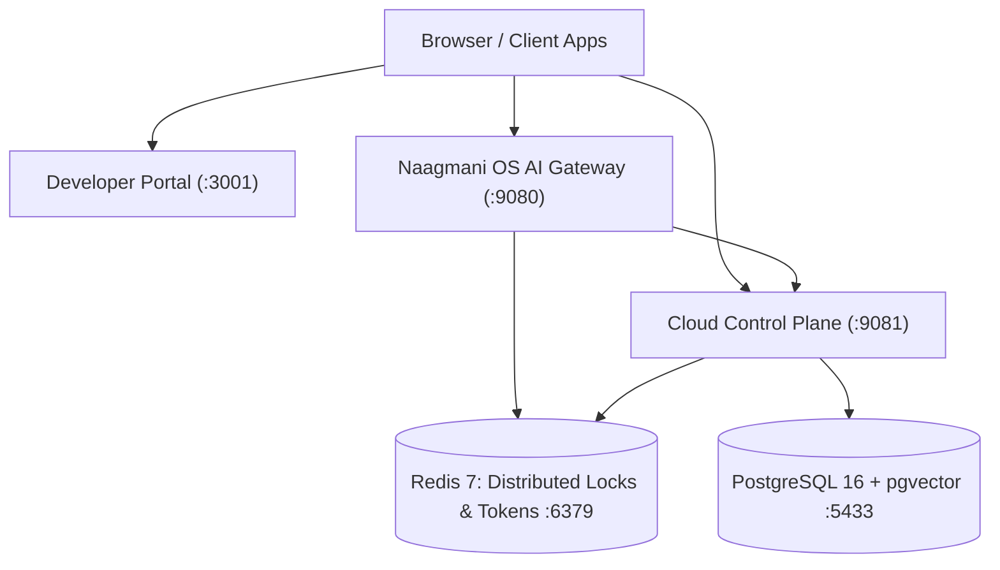

# Docker Compose Deployment

Deploy the complete, single-node **Naagmani AI Operating System** stack using Docker and Docker Compose.

---

## Architecture Overview

A production Docker Compose deployment includes 5 core services running in an isolated container network:



### Port Mapping & Services Summary

| Service | Host Port | Internal Port | Health Check | Description |
|---|---|---|---|---|
| **Developer Portal** | `3001` | `3000` | HTTP `GET /` | Next.js Developer & Admin Workspace UI |
| **Naagmani OS** | `9080` | `8080` | HTTP `GET /v1/health` | High-throughput AI proxy, BYOK vault & plugins |
| **Cloud Control Plane** | `9081` | `8080` | HTTP `GET /health` | Authentication, RBAC, organizations, and metering |
| **PostgreSQL 16** | `5433` | `5432` | `pg_isready` | Relational & vector store (Data Plane & Control Plane DBs) |
| **Redis 7** | `6379` | `6379` | `redis-cli ping` | In-memory token bucket rate limiting & atomic locks |

---

## Option 1: 1-Command Automated Installer (Recommended)

The fastest and most reliable way to deploy is using the official 1-command installer script. It validates prerequisites, generates cryptographically strong keys, sets up database schemas, pulls official multi-arch images from GHCR, and starts the stack:

### Linux / macOS
```bash
# Using curl:
curl -fsSL https://raw.githubusercontent.com/bhakha-services/naagmani/main/install.sh | bash

# Or using wget:
wget -qO- https://raw.githubusercontent.com/bhakha-services/naagmani/main/install.sh | bash
```

### Windows (PowerShell)
```powershell
iwr -useb https://raw.githubusercontent.com/bhakha-services/naagmani/main/install.ps1 | iex
```

---

## Option 2: Standalone GHCR Docker Compose (Zero Code Cloning)

If you prefer to inspect and manage the Docker Compose file directly without cloning the entire git repository:

```bash
# 1. Create deployment directory
mkdir -p ~/naagmani && cd ~/naagmani

# 2. Download the official standalone GHCR compose definition
curl -fsSL https://raw.githubusercontent.com/bhakha-services/naagmani/main/deployments/self-hosted/docker-compose.ghcr.yml -o docker-compose.yml

# 3. Create the database initialization script
cat << 'EOF' > init-databases.sql
SELECT 'CREATE DATABASE naagmani'
WHERE NOT EXISTS (SELECT FROM pg_database WHERE datname = 'naagmani')\gexec
EOF

# 4. Pull pre-built multi-arch images from GHCR
docker compose pull

# 5. Launch all services in background
docker compose up -d

# 6. Verify container health
docker compose ps
```

---

## Option 3: Build & Run from Source (Git Clone)

If you are contributing to Naagmani or wish to build all container images locally from source code:

1. Clone the repository and navigate to root:
   ```bash
   git clone https://github.com/bhakha-services/naagmani.git
   cd naagmani
   ```

2. Copy the production environment configuration:
   ```bash
   cp .env.production.example .env.production
   ```

3. Generate secure 32-byte encryption and session keys in `.env.production`:
   ```bash
   # AES-256 BYOK encryption key
   openssl rand -hex 32
   
   # Session secret
   openssl rand -hex 32
   ```

4. Build and start the platform stack:
   ```bash
   docker compose -f docker-compose.production.yml up -d --build
   ```

5. Verify running containers:
   ```bash
   docker compose ps
   ```

---

## Platform Lifecycle & Maintenance

Execute these commands inside your deployment directory (`~/naagmani`):

| Operation | Command |
|---|---|
| **Check service status** | `docker compose ps` |
| **Stream live logs** | `docker compose logs -f` |
| **Stream OS Gateway logs** | `docker compose logs -f os` |
| **Stream Cloud Control Plane logs** | `docker compose logs -f cloud` |
| **Stop cluster** | `docker compose down` |
| **Restart cluster** | `docker compose up -d` |
| **Update images to latest** | `docker compose pull && docker compose up -d` |

---

## Related Documentation

- [1-Command Automated Installation Guide](/deploy/installation)
- [Coolify Deployment Guide](/deploy/coolify)
- [Air-Gapped & Offline Setup](/deploy/offline)
