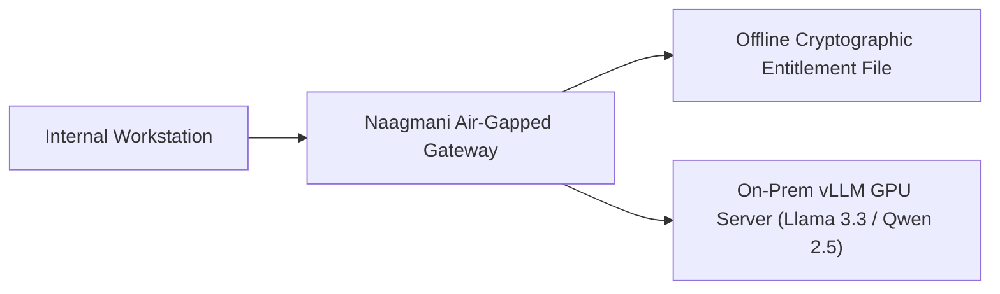

# Air-Gapped & Offline Setup

Deploy Naagmani in zero-egress, air-gapped secure enterprise environments.

---

## Architecture & License Entitlements

In an air-gapped deployment:
- Upstream AI inference targets private on-premises models (via **vLLM**, **Ollama**, or private GPU clusters).
- License entitlements are verified using offline cryptographic public key signatures without calling external license servers.



---

## Offline Installation Steps

1. Export container images on an internet-connected machine:
   ```bash
   docker save ghcr.io/bhakha-services/naagmani-os:latest ghcr.io/bhakha-services/naagmani-cloud:latest ghcr.io/bhakha-services/naagmani-developer:latest pgvector/pgvector:pg16 redis:7-alpine | gzip > naagmani-images.tar.gz
   ```
2. Transfer the archive to the secure air-gapped bastion host.
3. Load images into the local registry:
   ```bash
   gzip -dc naagmani-images.tar.gz | docker load
   ```
4. Select the self-hosted Compose profile and configure local portal authentication.
5. Import an Accounts-issued signed JSON license locally. Keep the OS data volume persistent.
6. Block vendor egress for the offline deployment and verify local operation. There is no implemented `NAAGMANI_AIR_GAPPED` enforcement switch.

See [Self-hosted boundaries](../deployment/self-hosted-boundaries.md) for the exact auth/license contract and limitations.

---

## Related Documentation

- [Providers & BYOK (Self-Hosted)](/developer-portal/organization/providers)
- [Docker Compose Deployment](/deploy/docker-compose)
