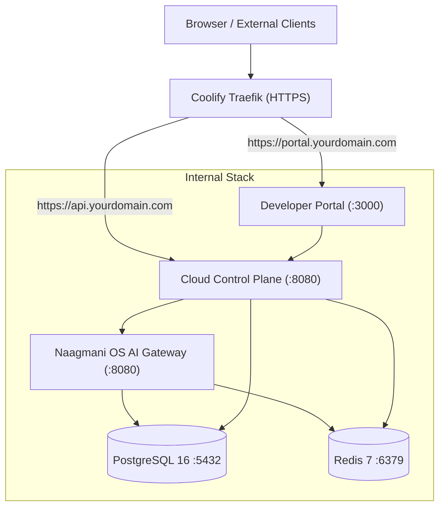

# Coolify PaaS Deployment Guide

Deploy the complete **Naagmani AI Operating System** into **Coolify** using official prebuilt OCI container images from the GitHub Container Registry (GHCR).

---

## 1. Overview & Architecture

When running under Coolify, Naagmani runs as a managed Docker Compose Stack:
- **Automatic Traefik Routing & SSL**: Coolify automatically manages Let's Encrypt certificates and reverse-proxies requests for `portal.yourdomain.com` (to `developer:3000`) and `api.yourdomain.com` (to `cloud:8080`).
- **Private Data Plane**: PostgreSQL, Redis, and `os` communicate exclusively over the internal bridge network (`selfhosted-network`).



---

## 2. Step-by-Step Coolify Deployment

### Step 1: Create a New Service in Coolify
1. In the Coolify Dashboard, navigate to your Project and select your Environment.
2. Click **+ New Resource**.
3. Select **Docker Compose** (under Services).
4. Name your stack: `naagmani-stack`.

### Step 2: Paste the Stack Manifest
In the Coolify Docker Compose editor, paste the following verified configuration:

```yaml
name: naagmani-coolify

services:
  postgres:
    image: pgvector/pgvector:pg16
    restart: unless-stopped
    environment:
      POSTGRES_USER: ${POSTGRES_USER:-naagmani}
      POSTGRES_PASSWORD: ${POSTGRES_PASSWORD:-naagmanipassword}
      POSTGRES_DB: ${POSTGRES_DB:-${POSTGRES_DB_CLOUD:-naagmani_selfhosted}}
    volumes:
      - selfhosted-postgres-data:/var/lib/postgresql/data
    healthcheck:
      test: ["CMD-SHELL", "pg_isready -U ${POSTGRES_USER:-naagmani} -d ${POSTGRES_DB:-${POSTGRES_DB_CLOUD:-naagmani_selfhosted}} && (psql -U ${POSTGRES_USER:-naagmani} -d ${POSTGRES_DB:-${POSTGRES_DB_CLOUD:-naagmani_selfhosted}} -tc \"SELECT 1 FROM pg_database WHERE datname = 'naagmani'\" | grep -q 1 || psql -U ${POSTGRES_USER:-naagmani} -d ${POSTGRES_DB:-${POSTGRES_DB_CLOUD:-naagmani_selfhosted}} -c \"CREATE DATABASE naagmani;\")"]
      interval: 5s
      timeout: 5s
      retries: 5
      start_period: 10s
    deploy:
      resources:
        limits:
          cpus: '2.0'
          memory: 2048M
        reservations:
          cpus: '0.5'
          memory: 512M
    networks:
      - selfhosted-network

  redis:
    image: redis:7-alpine
    restart: unless-stopped
    healthcheck:
      test: ["CMD", "redis-cli", "ping"]
      interval: 5s
      timeout: 5s
      retries: 5
      start_period: 5s
    deploy:
      resources:
        limits:
          cpus: '1.0'
          memory: 512M
        reservations:
          cpus: '0.2'
          memory: 128M
    networks:
      - selfhosted-network

  os:
    image: ghcr.io/bhakha-services/naagmani-os:${NAAGMANI_VERSION:-latest}
    restart: unless-stopped
    environment:
      NAAGMANI_ENV: ${NAAGMANI_ENV:-production}
      NAAGMANI_SERVER_HOST: 0.0.0.0
      NAAGMANI_SERVER_PORT: 8080
      NAAGMANI_PORT: 8080
      DATABASE_URL: postgres://${POSTGRES_USER:-naagmani}:${POSTGRES_PASSWORD:-naagmanipassword}@postgres:5432/${POSTGRES_DB_OS:-naagmani}?sslmode=disable
      NAAGMANI_REDIS_URL: redis://redis:6379/1
      REDIS_URL: redis://redis:6379/1
      NAAGMANI_LOG_LEVEL: ${NAAGMANI_LOG_LEVEL:-${LOG_LEVEL:-info}}
      NAAGMANI_LOG_FORMAT: json
      NAAGMANI_ENCRYPTION_KEY: ${NAAGMANI_ENCRYPTION_KEY}
      NAAGMANI_DATA_DIR: /home/naagmani/.naagmani
    volumes:
      - selfhosted-os-data:/home/naagmani/.naagmani
    expose:
      - "8080"
    healthcheck:
      test: ["CMD-SHELL", "wget -q -O - http://127.0.0.1:8080/v1/health > /dev/null || exit 1"]
      interval: 5s
      timeout: 5s
      retries: 5
      start_period: 15s
    depends_on:
      postgres:
        condition: service_healthy
    deploy:
      resources:
        limits:
          cpus: '2.0'
          memory: 2048M
        reservations:
          cpus: '0.5'
          memory: 512M
    networks:
      - selfhosted-network
      - coolify

  cloud:
    image: ghcr.io/bhakha-services/naagmani-cloud:${NAAGMANI_VERSION:-latest}
    restart: unless-stopped
    environment:
      APP_ENV: ${NAAGMANI_ENV:-production}
      NAAGMANI_ENV: ${NAAGMANI_ENV:-production}
      PORT: 8080
      NAAGMANI_CLOUD_PORT: 8080
      NAAGMANI_CLOUD_HOST: 0.0.0.0
      DATABASE_URL: postgres://${POSTGRES_USER:-naagmani}:${POSTGRES_PASSWORD:-naagmanipassword}@postgres:5432/${POSTGRES_DB:-${POSTGRES_DB_CLOUD:-naagmani_selfhosted}}?sslmode=disable
      REDIS_URL: redis://redis:6379/0
      NAAGMANI_REDIS_URL: redis://redis:6379/0
      JWT_SECRET: ${JWT_SECRET}
      NAAGMANI_SESSION_SECRET: ${NAAGMANI_SESSION_SECRET}
      COMMERCIAL_BILLING_ENABLED: "false"
      COMMERCIAL_LICENSE_ENABLED: "false"
      NAAGMANI_ADMIN_EMAIL: ${NAAGMANI_ADMIN_EMAIL:-admin@selfhosted.local}
      NAAGMANI_ADMIN_PASSWORD: ${NAAGMANI_ADMIN_PASSWORD}
      PORTAL_BASE_URL: ${PORTAL_BASE_URL}
      CLOUD_BASE_URL: ${CLOUD_BASE_URL}
      NAAGMANI_CORS_ALLOWED_ORIGINS: ${PORTAL_BASE_URL},${CLOUD_BASE_URL}
      NAAGMANI_OS_URL: http://os:8080
      LOG_LEVEL: ${LOG_LEVEL:-info}
    expose:
      - "8080"
    healthcheck:
      test: ["CMD-SHELL", "wget -q -O - http://127.0.0.1:8080/health > /dev/null || exit 1"]
      interval: 5s
      timeout: 5s
      retries: 5
      start_period: 15s
    depends_on:
      postgres:
        condition: service_healthy
      redis:
        condition: service_healthy
    deploy:
      resources:
        limits:
          cpus: '2.0'
          memory: 2048M
        reservations:
          cpus: '0.5'
          memory: 512M
    networks:
      - selfhosted-network
      - coolify

  developer:
    image: ghcr.io/bhakha-services/naagmani-developer:${NAAGMANI_VERSION:-latest}
    restart: unless-stopped
    environment:
      NODE_ENV: production
      PORT: 3000
      HOSTNAME: "0.0.0.0"
      PORTAL_BASE_URL: ${PORTAL_BASE_URL}
      NEXT_PUBLIC_CLOUD_API_URL: ${CLOUD_BASE_URL}
      NEXT_PUBLIC_API_BASE_URL: ${CLOUD_BASE_URL}
      NEXT_PUBLIC_OS_API_URL: ${OS_BASE_URL:-http://os:8080}
    expose:
      - "3000"
    healthcheck:
      test: ["CMD-SHELL", "wget -q -O - http://127.0.0.1:3000 > /dev/null || exit 1"]
      interval: 10s
      timeout: 5s
      retries: 5
      start_period: 20s
    depends_on:
      cloud:
        condition: service_healthy
    deploy:
      resources:
        limits:
          cpus: '2.0'
          memory: 1024M
        reservations:
          cpus: '0.2'
          memory: 256M
    networks:
      - selfhosted-network
      - coolify

networks:
  selfhosted-network:
    driver: bridge
  coolify:
    external: true

volumes:
  selfhosted-postgres-data:
  selfhosted-os-data:
```

### Step 3: Configure Domains in Coolify
1. In the `developer` service, set **Domains**: `https://portal.yourdomain.com` (Port `3000`).
2. In the `cloud` service, set **Domains**: `https://api.yourdomain.com` (Port `8080`).

### Step 4: Configure Environment Variables
In the **Environment Variables** tab, configure:

```ini
# --- Release Version ---
NAAGMANI_VERSION=latest

# --- Public Domains ---
PORTAL_BASE_URL=https://portal.yourdomain.com
CLOUD_BASE_URL=https://api.yourdomain.com

# --- Administrator Account ---
NAAGMANI_ADMIN_EMAIL=admin@yourdomain.com
NAAGMANI_ADMIN_PASSWORD=YourSecurePassword123!

# --- Cryptographic Secrets (32-byte hex) ---
NAAGMANI_ENCRYPTION_KEY=64_character_hex_key_for_byok_encryption
JWT_SECRET=64_character_hex_session_and_jwt_secret
NAAGMANI_SESSION_SECRET=64_character_hex_session_and_jwt_secret

# --- PostgreSQL Credentials ---
POSTGRES_USER=naagmani
POSTGRES_PASSWORD=your_secure_postgres_password
```

### Step 5: Deploy the Stack
1. Click **Deploy**.
2. Coolify pulls official multi-arch images from GHCR, provisions volumes, executes health probes, and binds SSL certificates automatically.
3. Once all services report **Healthy**, navigate to `https://portal.yourdomain.com` and log in.

---

## 3. Upgrading Naagmani in Coolify

To update to a newer release:
1. Update `NAAGMANI_VERSION` in your Coolify Environment Variables.
2. Click **Redeploy**.
3. Coolify performs a rolling update without downtime or data loss.
