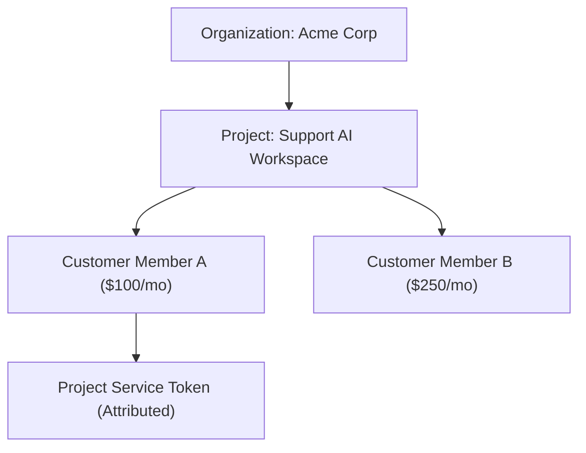

# Customer Members Directory & Spending Limits

The **Customer Members** directory allows you to manage end-user and application member identities for token usage attribution, per-member spending limits, and FinOps governance.

> [!TIP]
> **Project-Scoped Workspaces (Recommended)**  
> In Naagmani 4.7+, Customer Members are managed natively within individual Project workspaces:  
> Navigate to **Projects** -> Select Project -> **Members** ([Project Customer Members](projects/members.md)).  
> Navigating to `{{DEVELOPER_PORTAL_URL}}/members` provides an intelligent workspace router that directs you to your authorized project.

> [!IMPORTANT]
> **Customer Members vs. Portal Users**  
> Customer Members are application and end-user identities used by LLM workloads and backend services. They **do not** have Developer Portal login accounts.  
> To manage internal team members and administrators who have Developer Portal access, see [Portal Users](users.md).

---

## Setting Member-Specific Spending Limits

1. Navigate to the project workspace **Members** page at `{{DEVELOPER_PORTAL_URL}}/projects/[projectId]/members`.
2. Click **Add Customer Member** or select an existing member.
3. In the member modal or budget modal, enter the desired **Daily Limit Amount** or **Monthly Limit Amount** (e.g. `$200.00`).
4. Click **Save Budget**.

> [!NOTE]
> **Hierarchy Rule Enforcement**  
> A member's spending limit cannot exceed the parent Project or Organization monthly limit. If the project budget ceiling is $500, setting a member cap of $1,000 will be rejected with an error.

---

## Attribution in Workloads

Applications can attribute LLM inference calls to a specific Customer Member using:
- The `X-Naagmani-Member-Id` HTTP header.
- Binding the API Key or Service Token to a specific `member_id` or `external_user_id`.

---

## Next Steps

- [Project Customer Members](projects/members.md)
- [Portal Users Management](users.md)
- [Project Service Tokens](projects/service-tokens.md)
- [Customer Members API Reference](/docs/api/customer-members)

