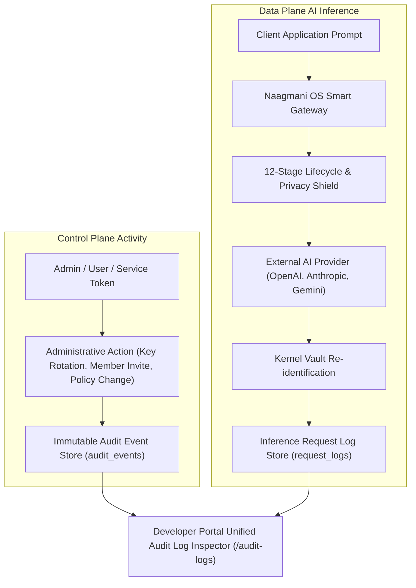
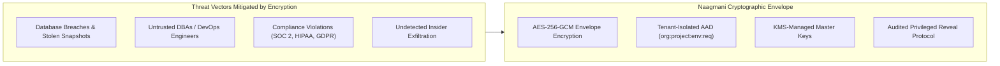

# Security Audit Logs & Inference Trace Observability

Maintain an immutable, tamper-evident audit trail of all administrative mutations, credential rotations, security events, and multi-boundary AI inference request execution traces across your organization.

- **Portal Location**: `Organization > Audit Logs` (`/audit-logs`) or `Projects > [Your Project] > Operations > Audit Logs` (`/projects/[slug]/audit-logs`)
- **API Endpoints**: `/v1/audit-logs`, `/v1/request-logs`, and `/v1/organizations/{orgID}/request-logs/{id}/reveal`

---

## 1. Unified Log Architecture

The Developer Portal provides a unified view distinguishing two critical telemetry streams:



1. **Audit Events (`audit_events`)**: High-integrity administrative log capturing who changed credentials, modified budgets, created projects, or triggered security overrides.
2. **API Inference Requests (`request_logs`)**: Deep runtime observability capturing latency, token consumption, 12-stage execution timelines, plugin transformation diffs, and multi-boundary payload snapshots.

---

## 2. Why Are Request Payloads Encrypted at Rest?

In modern enterprise AI systems, debugging prompt transformations, privacy sanitization, and routing decisions requires payload visibility. However, storing raw prompts and completions in cleartext introduces severe compliance and security risks.

Even though an Organization Owner has authoritative administrative privileges, Naagmani enforces **KMS Envelope Encryption (`encrypted_payload`)** at rest due to four critical threat models:



### Threat 1: Database Breaches & Snapshot Exfiltration
If a PostgreSQL volume snapshot, automated cloud backup, or database replica is exfiltrated or misconfigured, an attacker obtains only AES-256-GCM ciphertext (`enc:v1:...`). Without access to the master key residing in AWS KMS, HashiCorp Vault, or the dedicated KMS enclave, the stored payloads are cryptographically impossible to decrypt.

### Threat 2: Insider Threat & Untrusted DBA Access
Direct database administrators and infrastructure engineers running ad-hoc SQL queries (`SELECT * FROM request_logs`) cannot browse sensitive proprietary prompts, customer messages, or intellectual property. The ciphertext cannot be decrypted directly from database records.

### Threat 3: Compliance & Regulatory Mandates
Regulations such as **HIPAA** (e-PHI security rule), **GDPR** (data protection by design and default), and **SOC 2 Type II** require strict encryption at rest and least-privilege access controls for stored customer conversations.

### Threat 4: Non-Repudiation & Privileged Auditability
If payloads were stored unencrypted, any administrator with read access could browse customer prompts without leaving a paper trail. Under Naagmani's **Privileged Reveal Protocol**, every single decryption requires explicit justification and immutably records an audit event (`request_log.payload_reveal`) noting who viewed the prompt, when, and why.

> [!IMPORTANT]
> **Consequences of Unencrypted Payloads:** Storing prompts in cleartext exposes raw PII, sensitive customer data, and proprietary model outputs to anyone with read-replica access, eliminates compliance defensibility, and leaves organizations vulnerable to silent data exfiltration without an audit trail.

---

## 3. Configurable Payload Logging Policies

Naagmani allows organizations to balance developer debugging needs with enterprise compliance through three configurable policies:

| Policy | Storage State | Developer Portal Viewing | Recommended Environment | Compliance Level |
| :--- | :--- | :--- | :--- | :--- |
| `metadata_only` | Payloads are `null` (not stored) | Only latency, token metrics, and 12-stage status timeline are shown. | Production Default | Maximum (Strict HIPAA / GDPR) |
| `redacted_payload` | Stored as sanitized plaintext (PII masked, credentials stripped) | **Immediate direct viewing** in the portal without clicking Reveal. | Development & Staging | Balanced (Masked PII) |
| `encrypted_payload` | Stored as AES-256-GCM ciphertext (`enc:v1:...`) | Requires clicking **Reveal Payload** and entering a business justification. | Regulated Enterprise & Audit | Complete Forensic Protection |

### Strict Policy Precedence
A client request or child project can **never** weaken a stricter organization or platform restriction:

$$\text{Effective Policy} = \min(\text{Platform Max}, \text{Organization Policy}, \text{Project Preference})$$

---

## 4. Developer Portal Inspection Guide

### Step 1: Navigating to Audit Logs
1. From the left sidebar, navigate to **Organization > Audit Logs** (`/audit-logs`) or under your project at `Projects > [Project] > Operations > Audit Logs`.
2. Use the category selector to isolate telemetry:
   - **All Logs**: Unified chronological stream.
   - **Audit Events**: Control plane mutations (`api_key.created`, `member.role_updated`).
   - **API Requests**: Runtime AI inference requests (`/v1/chat/completions`).
   - **Security**: Security violations, rate limits, and payload reveal events.
3. Filter by **Status** (`Success`, `Blocked`, `Failed`), **Project**, **Environment** (`Production`, `Staging`, `Development`), **API Key / Actor**, or **Date Range** (Last 24h, 7d, 30d, 90d).

```
┌────────────────────────────────────────────────────────────────────────────────────────┐
│ [All Logs] [Audit Events] [API Requests] [Security]        [Search by Request ID/Actor] │
├────────────────────────────────────────────────────────────────────────────────────────┤
│ Status  | Timestamp            | Event / Request Type        | Actor / Key   | Latency │
├─────────┼──────────────────────┼─────────────────────────────┼───────────────┼─────────┤
│ Success | 2026-10-17 19:15:32  | POST /v1/chat/completions   | Backend App   | 634ms   │
│ Success | 2026-10-17 19:10:04  | request_log.payload_reveal  | dev@acme.com  | —       │
│ Blocked | 2026-10-17 19:02:11  | guardrail.dlp.blocked       | Portal User   | —       │
└────────────────────────────────────────────────────────────────────────────────────────┘
```

---

### Step 2: The 12-Stage Inference Trace Inspector

Clicking on any **API Request** row opens the **Inference Trace Inspector** slide-out drawer, displaying the request's exact lifecycle across 12 authentic runtime stages:

```mermaid
graph LR
    S1["1. Ingress"] --> S2["2. Auth"] --> S3["3. Policy"] --> S4["4. Pre-Req"]
    S4 --> S5["5. Router"] --> S6["6. Privacy Shield"] --> S7["7. Provider"]
    S7 --> S8["8. Response"] --> S9["9. Vault Detoken"] --> S10["10. Post-Resp"]
    S10 --> S11["11. Client Ready"] --> S12["12. Metering"]
```



1. **`ingress_received`**: Client HTTP connection opened at the edge gateway.
2. **`auth_evaluated`**: API Key or Project Service Token validated; rate limit check evaluated.
3. **`policy_resolved`**: Effective payload logging policy (`metadata_only`, `redacted_payload`, `encrypted_payload`) computed.
4. **`plugin_request_before`**: Early guardrails and request validators evaluated.
5. **`router_candidate_selected`**: Smart Router resolves model targets, latency health, and fallback cascade.
6. **`plugin_provider_before`**: Provider boundary hooks executed. Privacy Shield scans for PII entities (emails, phones, person names) and replaces them with cryptographic placeholders (`[PHONE_1]`, `[EMAIL_1]`). Mappings stored in Kernel Vault.
7. **`provider_dispatched`**: Sanitized payload sent to upstream model provider (OpenAI, Anthropic, Gemini).
8. **`provider_response_received`**: Raw completion returned by provider.
9. **`plugin_provider_after`**: Authorized token placeholders re-identified from Kernel Vault if the caller has `"privacy.reidentify"` scope.
10. **`plugin_response_before`**: Response sanitization, output guardrails, and compliance checks.
11. **`client_response_ready`**: Final completion serialized for the caller.
12. **`metering_completed`**: Billable token counts, COGS calculations, and FinOps metrics finalized.

---

### Step 3: Multi-Boundary Payload Inspector

The drawer contains 5 dedicated tabs providing zero-ambiguity visibility into each stage of transformation:

1. **Incoming Request**: The original payload submitted by the client application.
2. **Plugin Diffs**: Visual red/green diff badges displaying exact modifications made by each plugin (e.g. `messages[0].content` transformed with PII masking).
3. **Provider Request**: The exact sanitized payload sent over the wire to the external LLM provider.
4. **Provider Response**: The raw response generated by the external model provider before post-processing.
5. **Final Client Response**: The response delivered to the client, including any re-identified tokens.

---

### Step 4: Privileged Reveal Protocol (For Encrypted Payloads)

When an organization's policy is set to `encrypted_payload`, the payload inspector protects sensitive data by displaying an encryption notice:

> 🔒 **Payload Encrypted (AES-256-GCM)**  
> *This payload is encrypted at rest using KMS envelope encryption with Additional Authenticated Data (AAD) tenant isolation. Privileged access is required.*

To inspect the decrypted payload:

1. Click the **Reveal Decrypted Payload** button.
2. In the modal, provide a mandatory **Business Justification Reason** (e.g., `"Investigating tokenization anomaly in customer ticket #481"`).
3. Click **Confirm & Reveal**.
4. The system:
   - Validates that the caller holds the `audit.payload_reveal` permission (Organization Owner).
   - Verifies the Additional Authenticated Data (`orgID:projectID:envID:requestID`).
   - Retrieves the wrapped Data Encryption Key (DEK) and decrypts it via KMS.
   - Decrypts the payload in-memory.
   - Enforces the **Hard Secret Scrubbing Invariant** (scrubbing Bearer tokens, cookies, and keys).
   - Writes an immutable audit event:
     - **Event**: `security`
     - **Action**: `request_log.payload_reveal`
     - **Actor**: Caller Email & ID
     - **Metadata**: `{ "log_id": id, "reason": reason }`
5. The decrypted payload is rendered in the active session.

```
┌────────────────────────────────────────────────────────┐
│ 🔒 Request Decryption Authorization                    │
├────────────────────────────────────────────────────────┤
│ Viewing unencrypted payload data requires privileged   │
│ authorization. This action is permanently logged to    │
│ your organization's security audit trail.              │
│                                                        │
│ Business Justification (Required):                     │
│ [ Investigating ticket #481 tokenization error....... ]│
│                                                        │
│ [ Cancel ]                       [ Confirm & Reveal ] │
└────────────────────────────────────────────────────────┘
```

---

### Step 5: How to Avoid the Reveal Prompt (`redacted_payload` Mode)

If your team is in active development or debugging and prefers to see request and response payloads **immediately** without clicking "Reveal Decrypted Payload" every time:

1. Switch your organization's logging policy to **`redacted_payload`**.
2. In `redacted_payload` mode:
   - All PII (phones, emails, names) is automatically tokenized by the Privacy Shield before storage.
   - All authorization credentials and API keys are scrubbed.
   - The sanitized payload is stored directly and loads instantly in the Developer Portal drawer.

---

## 5. Configuring Policies via API & Portal

### Via Developer Portal
1. Navigate to **Organization Settings > Retention & Privacy Policy**.
2. Under **Payload Logging Policy**, select:
   - `metadata_only`
   - `redacted_payload`
   - `encrypted_payload`
3. Set your **Data Retention Period** (between 7 and 365 days).
4. Click **Save Changes**.

### Via Management API

```bash
# Update organization payload logging and retention policy
curl -X PUT "https://api.naagmani.com/v1/organizations/{orgID}/retention" \
  -H "Authorization: Bearer <ADMIN_OR_OWNER_TOKEN>" \
  -H "Content-Type: application/json" \
  -d '{
    "payload_logging_policy": "encrypted_payload",
    "retention_days": 30
  }'
```

#### API Response:
```json
{
  "organization_id": "org_d016adfc-f0e6-436a-9271-86a106392d28",
  "retention_days": 30,
  "payload_logging_policy": "encrypted_payload",
  "updated_at": "2026-10-17T19:30:00Z"
}
```

### Performing Privileged Reveal via API

```bash
curl -X POST "https://api.naagmani.com/v1/organizations/{orgID}/request-logs/{logID}/reveal" \
  -H "Authorization: Bearer <OWNER_TOKEN>" \
  -H "Content-Type: application/json" \
  -d '{
    "reason": "Investigating false-positive PII masking in production inference"
  }'
```

---

## 6. Hard Secret Scrubbing Invariant

Regardless of whether an organization selects `metadata_only`, `redacted_payload`, or `encrypted_payload`, Naagmani enforces an unbreakable security invariant:

```
[Incoming Headers / Payloads]
            │
            ▼
┌───────────────────────────────────────┐
│       ScrubHardSecrets() Filter       │
│  - Authorization: Bearer <TOKEN>      │
│  - X-Api-Key: nm_live_...             │
│  - Cookie / Set-Cookie session tokens │
│  - Password / Secret fields           │
│  - Private cryptographic keys         │
└───────────────────────────────────────┘
            │
            ▼
[Safe Snapshots Stored or Revealed]
```

Hard credentials and cryptographic keys are **never written to disk, never stored in ciphertext envelopes, and never returned in decrypted reveal responses**.

---

## 7. Related Documentation

- [Inference Payload Observability & Security Architecture](file:///e:/project/naagmani-project/naagmani-docs/docs/security/inference-observability.md)
- [AI Guardrails & Privacy Shield](file:///e:/project/naagmani-project/naagmani-docs/docs/developer-portal/governance-routing/guardrails.md)
- [Roles & Permissions (RBAC)](file:///e:/project/naagmani-project/naagmani-docs/docs/developer-portal/organization/roles.md)
- [API Keys & Vault Security](file:///e:/project/naagmani-project/naagmani-docs/docs/developer-portal/projects/api-keys.md)
- [Provider Attempt Accounting & Telemetry](file:///e:/project/naagmani-project/naagmani-docs/docs/developer-portal/operations/attempts.md)
