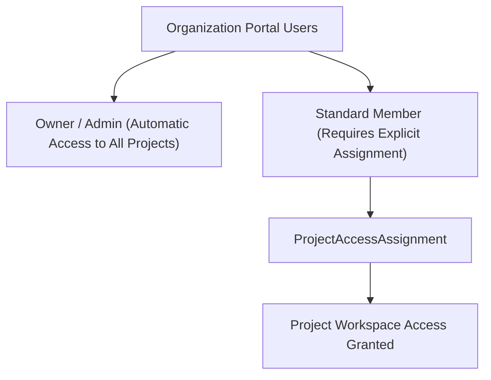

# Project Access & Portal User Authorization

The **Project Access** section controls which human Portal Users have permission to enter, view, and manage an individual Project workspace.

- **Portal Location**: `Projects & Workspaces > [Project] > Access & Authorization` (`/projects/[projectId]/access`)
- **API Endpoint**: `/v1/organizations/{orgID}/projects/{projectID}/users`

---

## 1. Access Model & Built-in Roles

Naagmani enforces strict project authorization boundaries:

1. **Automatic Administrative Access**: Organization **Owners** and **Admins** retain automatic organization-wide access to all project workspaces across all installations without requiring explicit assignment records.
2. **Explicit Assignment for Standard Users**: All other organization users require an explicit `ProjectAccessAssignment` to enter the workspace.
3. **Fail-Closed Isolation**: Standard users cannot view project dashboards, members, service tokens, or API keys for projects to which they are not assigned (`403 Forbidden`).
4. **Inherited Authority**: Permissions within an assigned project workspace (e.g. creating members, rotating tokens) are authoritative and inherited from the user's Organization Role.

---

## 2. Managing Project Access in Developer Portal

### Assigning a Team Member to a Project
1. Navigate to the target project workspace: **Projects** -> Select Project -> **Access & Authorization** (`/projects/[projectId]/access`).
2. Click **Assign Portal User**.
3. Select an active team member from the organization dropdown.
4. Click **Confirm Assignment**. The user will now see this project in their project switcher.

### Revoking Project Access
1. Locate the assigned user in the table under **Assigned Portal Users**.
2. Click the trash icon / **Revoke Access**.
3. Confirm the revocation dialog.
4. Access is invalidated immediately. In-flight sessions or cached views in the user's browser fail closed on their next operation.

---

## 3. Empty State & Disambiguation

- **Zero Assignments**: A user assigned to zero projects sees an informative empty state advising them to contact their organization administrator for project access. No unauthorized project names or descriptions are exposed.
- **Single Assignment**: Navigating to generic project links automatically redirects to the user's single authorized workspace.

---

## Related Documentation

- [Portal Users vs Customer Members](/concepts/portal-users-vs-customer-members)
- [Project Access API Reference](/api/project-access)
- [Project Customer Members](members.md)
