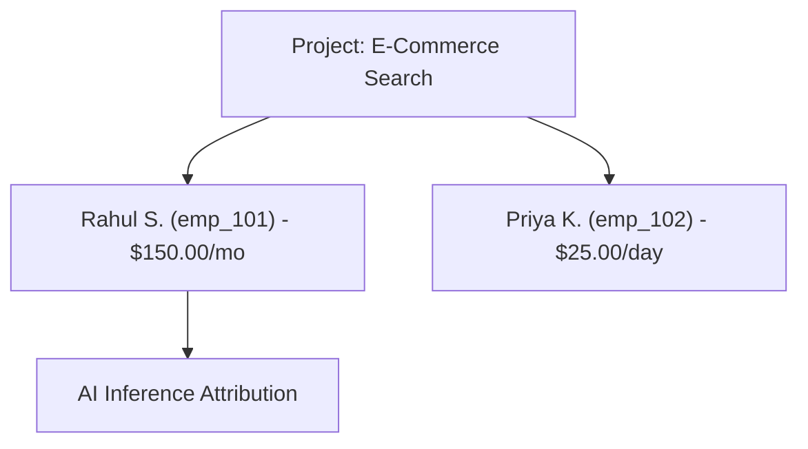

# Project Customer Members

The **Project Customer Members** directory allows managing application end-user identities, external user mappings, and per-member FinOps budgets strictly within an active Project workspace.

- **Portal Location**: `Projects & Workspaces > [Project] > Members` (`/projects/[projectId]/members`)
- **API Endpoint**: `/v1/organizations/{orgID}/projects/{projectID}/members`



---

## 1. What are Project Customer Members?

Customer Members represent:
- **Application End Users**: Developers, employees, or customers using AI features built on Naagmani.
- **Cost Centers**: Distinct entities for tracking token expenditure and enforcing monetary budget ceilings.
- **Attribution Anchors**: Targets for the `X-Naagmani-Member-Id` header during inference.

> [!NOTE]
> Customer Members are distinct from human **Portal Users**. They do not log in to the Developer Portal. To grant teammates access to this project workspace, see [Project Access & Authorization](access.md).

---

## 2. Managing Members in the Developer Portal

### Adding a Customer Member
1. Open the project workspace and navigate to **Members** (`/projects/[projectId]/members`).
2. Click **+ Add Member**.
3. Fill in the member details:
   - **Name**: Human-readable label (e.g. `Rahul Sharma`).
   - **Email**: Notification or contact email (must be unique within this project).
   - **External User ID**: Authoritative third-party identifier (e.g. `emp_101`, `okta_usr_99182`).
   - **Status**: `Active` or `Inactive`.
   - **Daily Budget Cap**: Optional maximum USD limit per day.
   - **Monthly Budget Cap**: Optional maximum USD limit per calendar month.
4. Click **Save Member**.

### Updating Budgets
1. In the members table, locate the member and click **Edit Budget**.
2. Enter the updated daily or monthly amounts.
3. Limits take effect immediately across all project API keys and service tokens attributing to this member.

### Deactivating or Deleting
- Setting status to **Inactive** or deleting the member immediately rejects subsequent inference requests attributing to that member (`403 Forbidden`).

---

## 3. Workload Attribution

Pass the member's canonical ID (`mbr_...`) in your backend inference calls:

```bash
curl -X POST "{{GATEWAY_URL}}/v1/chat/completions" \
  -H "Authorization: Bearer <PROJECT_SERVICE_TOKEN>" \
  -H "X-Naagmani-Member-Id: mbr_01J8K3M90A" \
  -H "Content-Type: application/json" \
  -d '{
    "model": "gpt-4o",
    "messages": [{"role": "user", "content": "Analyze product review"}]
  }'
```

---

## Related Documentation

- [Customer Members Concept](/concepts/customer-members)
- [Customer Members API Reference](/api/customer-members)
- [Project Access & Authorization](access.md)
- [Project Service Tokens](service-tokens.md)
