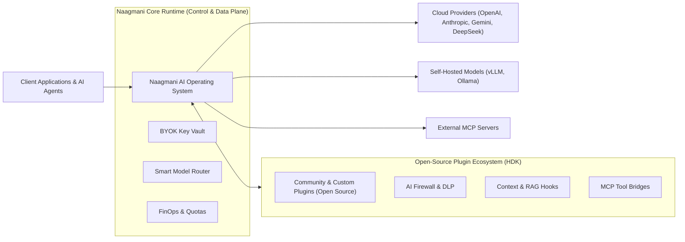
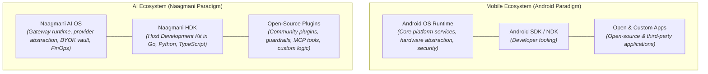
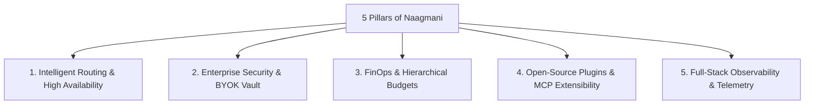

# What is Naagmani?

Naagmani is an enterprise-grade **AI Operating System and Control Plane** designed to govern, route, observe, and extend large language model (LLM) workloads across hybrid multi-model infrastructure.

Available with a **Community (DefaultFree) tier** for developers alongside commercial enterprise plans, Naagmani delivers a unified, highly optimized runtime and management plane that decouples modern software applications from volatile, fragmented AI providers.

---

## The Vision: The "Android OS for AI"

To understand Naagmani's architectural philosophy, consider how **Android OS** structured the mobile computing ecosystem:

### 1. The Core Operating System Runtime
Just as Android abstracts varied device hardware (chipsets, cameras, sensors) behind a standardized operating system interface with unified process management and security sandboxing, **Naagmani AI OS** provides the foundational system runtime for AI:
- **Universal Provider Abstraction**: Connect once to Naagmani's OpenAI-compatible endpoint to access OpenAI, Anthropic Claude, Google Gemini, DeepSeek, or private self-hosted models (vLLM, Ollama).
- **Enterprise Security & BYOK Vault**: Zero-knowledge AES-256 encrypted credential vault, scoped API keys, and Project Service Tokens.
- **Sub-50ms Smart Failover**: Dynamic cascade routing that absorbs upstream outages, rate limits, and latency spikes without client disruptions.
- **Hierarchical FinOps**: Centralized budget ceilings, token tracking, and department-level spend caps.

### 2. The Open-Source Plugin & Developer Ecosystem
While the core operating system and control plane provide the resilient engine, **all plugins in Naagmani are 100% open source and community-driven**:
- **Anyone Can Build Plugins**: Developers and teams can build custom plugins using the **Naagmani Host Development Kit (HDK)** in **Go**, **Python**, or **TypeScript**.
- **Open Standards & Extensibility**: Plugins communicate with the runtime via an out-of-process, high-speed wire protocol (`naagmani.plugin/v1`), ensuring sandboxed execution that cannot crash the core OS.
- **Open-Source Marketplace**: Developers can publish, discover, and install open-source community plugins or maintain private internal plugins for specialized enterprise workflows.

### What Can You Build with Plugins?
Developers use Naagmani's open-source plugin framework to build diverse capabilities, including:
- **AI Firewalls & DLP**: Inspect prompts in real time to redact PII (Personally Identifiable Information), block prompt injections, and detect toxic inputs before requests reach external models.
- **RAG & Dynamic Context Injection**: Intercept incoming queries to retrieve semantic vector embeddings from enterprise knowledge bases and augment model prompts on the fly.
- **Custom Tool & Protocol Adapters**: Transform internal proprietary RPC or REST services into OpenAI-compatible tool definitions.
- **MCP (Model Context Protocol) Bridges**: Connect autonomous agents with secure file systems, database connectors, and SaaS integrations.
- **Custom Routing Heuristics**: Implement domain-specific cost-optimization formulas or custom tier-based routing.

---

## Core Mission: Why Naagmani?

Modern software architectures face critical challenges when scaling AI applications to production:

1. **Provider Outages & Rate Limits**: Relying on a single AI provider leads to service disruptions during upstream outages or HTTP 429 rate limit spikes.
2. **Sprawling API Keys & Security Risks**: Embedding raw third-party provider keys in microservices creates credential leakage and compliance risks.
3. **Runaway LLM Spend**: Without centralized budget ceilings, token quotas, and cost-aware routing, AI costs spiral unpredictably.
4. **Lack of Standard Governance**: Teams lack unified policy enforcement for Data Loss Prevention (PII masking), content moderation, and tool execution approval.
5. **Ecosystem Lock-In**: Expanding agent capabilities with custom tools and external Model Context Protocol (MCP) servers requires bespoke glue code for every application.

Naagmani eliminates these bottlenecks by providing a **unified OpenAI-compatible AI gateway, developer portal, and extensible open-source plugin runtime**.

---

## The 5 Pillars of Naagmani

### 1. Intelligent Routing & High Availability
Define virtual model aliases (e.g., `smart`, `fast`, `code-gen`) backed by multi-provider cascade policies. Naagmani dynamically selects the optimal model using strategies like **Lowest Latency**, **Lowest Cost**, **Priority**, or **Weighted Proportions**, automatically failing over to standby providers within milliseconds during outages or rate limits.

### 2. Enterprise Security & BYOK Vault
Store your upstream provider API keys securely in an AES-256 encrypted Bring-Your-Own-Key (BYOK) vault. Client applications authenticate using scoped **API Keys** or **Project Service Tokens**, ensuring raw provider credentials never leave the gateway perimeter.

### 3. FinOps & Hierarchical Budgets
Enforce strict budget ceilings, hard/soft spending thresholds, and rate limits across Organizations, Projects, and Environments. Real-time token metering tracks exact prompt and completion costs per request.

### 4. Open-Source Plugins & MCP Extensibility
Extend gateway behavior with open-source plugins built with the **Host Development Kit (HDK)** in Go, Python, or TypeScript. Orchestrate autonomous AI agents equipped with reusable **Skills**, JSON-schema **Tools**, and external **Model Context Protocol (MCP)** servers with fine-grained human-in-the-loop approval policies.

### 5. Full-Stack Observability & Telemetry
Inspect hop-by-hop execution traces through **Provider Attempt Accounting**. Every upstream attempt, latency metric, fallback trigger, and prompt token count is recorded in an immutable audit ledger.

---

## How Developers Interact with Naagmani

The platform is designed around four unified touchpoints:

| Touchpoint | Primary Purpose | Interface |
|---|---|---|
| **Developer Portal** | Configure organizations, projects, providers, routing policies, guardrails, and monitor analytics. | Web UI (`:3000`) |
| **Unified API** | Dispatch OpenAI-compatible chat completions, responses, and embeddings. | REST & SSE (`:8080`) |
| **HDK & Plugin Marketplace** | Build, publish, and run custom open-source plugins and tool extensions. | Host Development Kit (Go, Python, TS) |
| **Naagmani CLI** | Manage local dev workflows, validate manifests, run diagnostics, and automate CI/CD. | Command Line (`naagmani`) |

---

## Next Steps

- Understand the architectural mental model: [How Naagmani Works](/get-started/how-it-works)
- Set up your first project and credentials: [Quickstart Guide](/get-started/quickstart)
- Send your first inference request: [Make Your First AI Request](/get-started/first-request)
- Build your first custom plugin: [Plugin Development Guide](/plugins/development)
