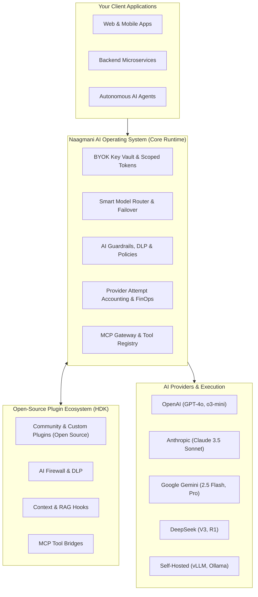
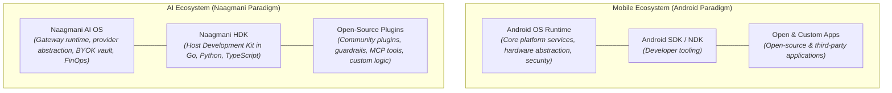

# What is Naagmani?

**Naagmani** is an enterprise-grade **AI Operating System & Gateway Runtime** designed to govern, optimize, and secure all Large Language Model (LLM) traffic across your engineering ecosystem.

Available with a **Community (DefaultFree) tier** for developers alongside commercial enterprise plans, Naagmani delivers a unified, highly optimized runtime and management plane that decouples modern software applications from volatile, fragmented AI providers.

---

## The Vision: The "Android OS for AI"

Often described as the **"Android OS for AI"**, Naagmani acts as a centralized intelligent runtime layer between your application code and the fragmented landscape of foundational model providers.

### 1. The Core Operating System Runtime
Just as Android abstracts varied device hardware (chipsets, cameras, sensors) behind a standardized operating system interface with unified process management and security sandboxing, **Naagmani AI OS** provides the foundational system runtime for AI:
- **Universal Provider Abstraction**: Connect once to Naagmani's OpenAI-compatible endpoint to access OpenAI, Anthropic Claude, Google Gemini, DeepSeek, or private self-hosted models (vLLM, Ollama).
- **Enterprise Security & BYOK Vault**: Zero-knowledge AES-256 encrypted credential vault, scoped API keys, and Project Service Tokens.
- **Sub-50ms Smart Failover**: Dynamic cascade routing that absorbs upstream outages, rate limits, and latency spikes without client disruptions.
- **Hierarchical FinOps**: Centralized budget ceilings, token tracking, and department-level spend caps.

### 2. The Open-Source Plugin & Developer Ecosystem
While the core operating system and control plane provide the resilient engine, **all plugins in Naagmani are 100% open source and community-driven**:
- **Anyone Can Build Plugins**: Developers and teams can build custom plugins using the **Naagmani Host Development Kit (HDK)** in **Go**, **Python**, or **TypeScript**.
- **Open Standards & Extensibility**: Plugins communicate with the runtime via an out-of-process, high-speed wire protocol (`naagmani.plugin/v1`), ensuring sandboxed execution that cannot crash the core OS.
- **Open-Source Marketplace**: Developers can publish, discover, and install open-source community plugins or maintain private internal plugins for specialized enterprise workflows.

### What Can You Build with Plugins?
Developers use Naagmani's open-source plugin framework to build diverse capabilities, including:
- **AI Firewalls & DLP**: Inspect prompts in real time to redact PII (Personally Identifiable Information), block prompt injections, and detect toxic inputs before requests reach external models.
- **RAG & Dynamic Context Injection**: Intercept incoming queries to retrieve semantic vector embeddings from enterprise knowledge bases and augment model prompts on the fly.
- **Custom Tool & Protocol Adapters**: Transform internal proprietary RPC or REST services into OpenAI-compatible tool definitions.
- **MCP (Model Context Protocol) Bridges**: Connect autonomous agents with secure file systems, database connectors, and SaaS integrations.
- **Custom Routing Heuristics**: Implement domain-specific cost-optimization formulas or custom tier-based routing.

---

## Why Do You Need an AI Operating System?

Building modern AI applications directly against individual provider APIs introduces critical enterprise bottlenecks:

| Challenge with Direct Provider Calls | How Naagmani Solves It |
| :--- | :--- |
| **Provider Lock-In & Breaking Changes** | Unified OpenAI-compatible API format across all providers. Switch models with zero code changes. |
| **Outages & Rate Limit Disruptions** | Automatic retry cascades and dynamic failover across providers in under 50ms. |
| **Sprawling API Keys & Security Risks** | Centralized Bring-Your-Own-Key (BYOK) encrypted vault and scoped Project Service Tokens. |
| **Runaway Costs & Unpredictable Bills** | Hierarchical FinOps spending caps (Organization $\rightarrow$ Project $\rightarrow$ Member) with real-time token tracking. |
| **Tool Calling & Agent Fragmentation** | Native Model Context Protocol (MCP) server integration and tool execution sandboxing. |

---

## The Naagmani Mental Model

To understand how Naagmani organizes workloads, consider the following structural hierarchy:

1. **Organization**: The top-level account and billing tenant (e.g. Acme Corp). Governs aggregate spending limits, team members, and enterprise audit logs.
2. **Project**: An isolated application or business initiative (e.g. *Customer Support Bot*, *Internal Copilot*).
3. **Environment**: Deployment stages within a project (*Test* and *Production*) with segregated secrets, routing rules, and rate limits.
4. **Service Tokens & API Keys**: Scoped credentials issued to services or developers with explicit capability matrices and optional member attribution.
5. **Smart Routing & Attempts**: Intelligent multi-hop dispatch engine that executes upstream provider calls, logs durable latency and token accounting, and handles failovers automatically.
6. **Open-Source Plugins & HDKs**: Out-of-process hooks that extend request lifecycles without compromising core engine stability.

---

## Next Steps

- Explore the business and engineering rationale: [Why Naagmani?](why-naagmani.md)
- Learn about the multi-plane system architecture: [Architecture Overview](architecture.md)
- Send your first AI request in under 3 minutes: [Quickstart Guide](../get-started/first-request.md)
- Build your first custom plugin: [Plugin Development Guide](../plugins/development.md)
- Access the web management console: [Developer Portal Overview](../developer-portal/overview.md)
