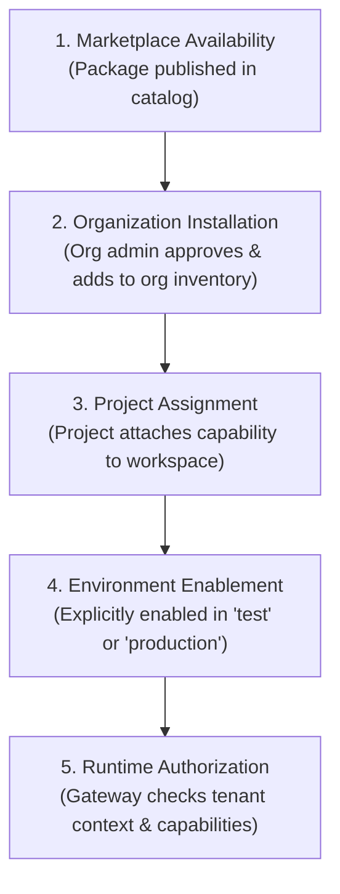

# Installation & Scope Isolation

Install capabilities, plugins, and tools from the marketplace with strict multi-tenant isolation, granular project assignment, and environment segregation.

---

## The 5-Phase Scoping Model

Naagmani enforces a zero-implicit-trust model for all plugins and marketplace capabilities. A capability published globally never executes inside your workloads until it passes five independent administrative boundaries:



---

## Detailed Isolation Boundaries

### Phase 1: Public Marketplace Availability
- **Scope**: Global catalog.
- **State**: The plugin package has passed automated linting, SHA-256 verification, and security scanning.
- **Access**: Developers can discover and inspect the manifest. **No code executes** in any customer environment.

### Phase 2: Organization Installation
- **Scope**: Organization level (`org_id`).
- **Permission**: Organization Admin or Owner.
- **Action**: The organization downloads or references the signed artifact. The plugin is added to the organization's private capability registry.
- **Isolation Guarantee**: Still not available to individual projects until explicitly assigned.

### Phase 3: Project Assignment
- **Scope**: Specific Project (`project_id`).
- **Permission**: Project Admin or Developer.
- **Action**: Project attaches the plugin to its pipeline configuration.
- **Isolation Guarantee**: Other projects within the same organization remain completely unaffected and isolated.

### Phase 4: Environment Enablement (`test` vs `production`)
- **Scope**: Target deployment tier.
- **Valid Environments**: Exactly `test` or `production`.
- **Configuration & Secrets**:
  - Environment variables, secret tokens, and webhook URLs are configured independently per tier.
  - A plugin enabled in `test` is **never** automatically enabled in `production`.
  - Upgrading a plugin version in `test` does not touch the pinned version running in `production`.

### Phase 5: Runtime Authorization & Policy Enforcement
- **Scope**: Per-request execution inside Naagmani OS gateway.
- **Enforcement Layer**: `ProviderSecurityBoundary` and `PluginSupervisor`.
- **Validation**:
  - Validates `X-Project-Id` and `X-Environment` against the authenticated bearer token (`nst_live_...`).
  - Cross-environment token substitution (e.g. using a `test` token in `production`) is rejected with HTTP 403 Forbidden.
  - Declared capabilities (e.g., `dlp.mask`, `audit.log`) are checked against project policy before hook invocation.

---

## CLI Installation Commands

Install into a specific project and environment:

```bash
# Install to 'test' environment for integration verification
naagmani plugin install email-guardrail \
  --project-id "proj_01J8F9X..." \
  --env "test" \
  --version "1.0.0"

# Promote to 'production' once verified
naagmani plugin install email-guardrail \
  --project-id "proj_01J8F9X..." \
  --env "production" \
  --version "1.0.0"
```

---

## Developer Portal Management

1. Navigate to **Organization > Marketplace** (`/marketplace`).
2. Click **Install** on the desired capability.
3. Select the target **Project** and **Environment** (`test` or `production`).
4. Configure environment-specific encrypted parameters (e.g. Slack Webhook, API endpoints).
5. Click **Confirm Installation**. The gateway supervisor spawns and health-checks the isolated worker.

---

## Related Documentation

- [Environments & Cryptographic Isolation](/concepts/environments)
- [Marketplace Publishing Lifecycle](/marketplace/publishing)
- [CLI Plugin Reference](/build/cli/plugins)
