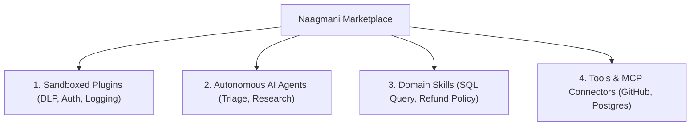

# Marketplace Overview

The **Naagmani Marketplace** is a centralized ecosystem for discovering, distributing, and installing modular AI capabilities, sandboxed plugins, domain skills, and tool extensions.

- **Portal Location**: `Organization > Marketplace` (`/marketplace`)
- **API Endpoint**: `/v1/marketplace`

---

## What is the Marketplace?

The Marketplace extends the core Naagmani AI Operating System by enabling developers to share and install pre-built capabilities without writing custom boilerplate integration code:

---

## Capability Categories

1. **Sandboxed Plugins**: Native Go, Node.js, and Python worker processes implementing the [Naagmani HDK](/build/hdks/overview) wire protocol. They hook directly into the gateway's request/response pipeline.
2. **AI Agents**: Pre-configured reasoning agents with specialized system prompts and multi-tool orchestration workflows.
3. **Domain Skills**: Standardized procedural instructions and guidelines that can be attached to any project agent.
4. **Tools & Connectors**: Production-ready API bindings and external Model Context Protocol (MCP) server packages.

---

---

## VS Code-Style Artifact Detail Experience

Selecting any artifact card in the marketplace opens an in-depth **Artifact Detail Dialog** engineered around developer workflows (similar to the Visual Studio Code Extensions Manager):

- **Deep Linking Support**: Every artifact has a permalink URL (e.g. `/marketplace?artifact=naagmani-privacy-shield`) that directly opens its detail view for sharing across teams.
- **Publisher & Provenance Metadata**: Clear visual indicators for certification by the Naagmani Security Team, enterprise entitlement tier, SemVer versions, Ed25519 signature checksums, and license.
- **Six Comprehensive Detail Tabs**:
  1. **Overview**: Zero-danger safe Markdown README rendering complete with architecture diagrams, callouts, and usage rationale.
  2. **Features**: Structured capability cards outlining core detection, security boundaries, and tokenization algorithms.
  3. **Installation & Scope**: Real-time visibility into active project deployments across `test` and `production` environments, accompanied by the manifest's configurable schema defaults.
  4. **Permissions & Security**: Least-privilege capability breakdown classifying requested permissions (`request.read`, `request.modify`, `response.read`, `response.modify`) by risk level, runtime intercept hook attachments (`provider.before`, `provider.after`), `fail_close` failure policies, and cryptographic verification digests.
  5. **Changelog & Versions**: Immutable version release history with published timestamps and artifact SHA-256 archives.
  6. **Documentation**: Developer quickstart commands (`naagmani plugins install ...`), direct guide links, and sandbox test cURL recipes.

---

## Trust Verification & Security Scopes

Every item published to the marketplace undergoes automated security scanning:
- **Checksum Verification**: SHA-256 binary validation on all packaged release archives.
- **Manifest Permission Review**: Declared execution hooks (`provider.before`, `provider.after`) and network egress boundaries are strictly verified.
- **Project Isolation**: Installing a plugin into `Project A` never automatically exposes that capability to `Project B` unless explicitly authorized.

---

## Next Steps

- Learn how to browse and filter catalog items: [Discover & Search](/marketplace/discover)
- Learn how to install capabilities: [Installation & Scope Isolation](/marketplace/installation)
- Explore reference security plugin: [Naagmani Privacy Shield](/plugins/privacy-shield)
- Learn how to distribute your own capabilities: [Publisher Portal](/marketplace/publishing)

