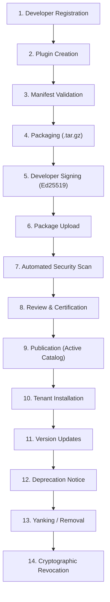

# Marketplace Publishing & Lifecycle

Package, sign, verify, and publish custom plugins, agents, skills, and tools to private organization registries or the public Naagmani Marketplace catalog.

- **Developer Portal**: `Organization > Publisher` (`/publisher`)
- **API Endpoint**: `POST /v1/marketplace/publish`
- **CLI Commands**: `naagmani plugin [validate|package|publish]`

---

## 14-Step Publishing & Lifecycle Model

Naagmani implements a strict, verified publishing lifecycle to ensure plugin safety, supply-chain integrity, and cryptographic authenticity:

---

## Step-by-Step Lifecycle Specification

### Step 1: Developer Registration & Publisher Identity
- **Actor / Permission**: Organization Member with `developer` or `admin` role.
- **Action**: Authenticate via CLI using `naagmani login` or pass `NAAGMANI_TOKEN`.
- **Identity Artifact**: Publisher identity is bound to `org_id` and verified user email.

### Step 2: Plugin Creation
- **CLI Command**: `naagmani plugin create <name> --language go|node|python`
- **Output**: Initialized scaffold containing `plugin.json` and canonical HDK imports.

### Step 3: Manifest Validation
- **CLI Command**: `naagmani plugin validate .`
- **Enforcement**: Checks `api_version: "v1"`, SemVer `version`, declared `hooks`, and strictly validates declared `capabilities` (e.g. `dlp.mask`, `audit.log`) against platform policies.
- **Common Error**: `ExitValError (Code 3)`: Invalid hook name or missing `runtime.command`.

### Step 4: Deterministic Packaging
- **CLI Command**: `naagmani plugin package .`
- **Mechanism**: Builds `.tar.gz` bundle excluding VCS directories (`.git`), tests, and local build artifacts.
- **Integrity**: Calculates SHA-256 digest of the raw archive bytes.

### Step 5: Package Signing
- **Mechanism**: Developer signs the SHA-256 digest with an Ed25519 private key.
- **Public Key**: Submitted or bound to the organization publisher profile.

### Step 6: Package Upload
- **CLI Command**: `naagmani plugin publish . --visibility organization`
- **API Payload**: Multi-part upload containing the tarball archive, manifest JSON, and hex-encoded Ed25519 signature.

### Step 7: Automated Security Checks
- **Cloud Ingestion Pipeline**:
  - Sandboxed detonation and binary analysis.
  - Antivirus and malicious payload signature scanning.
  - Static analysis to verify no undeclared network egress or raw standard I/O pollution.

### Step 8: Review & Certification
- **Certification States**:
  - `UNDER_REVIEW`: Automated checks completed; queued for policy review.
  - `APPROVED`: Verified for internal organization distribution.
  - `CERTIFIED`: Certified for public marketplace discovery.

### Step 9: Publication
- **Registry Update**: Package status advances to `PUBLISHED`.
- **Catalog Visibility**: Accessible via `naagmani marketplace search` and Developer Portal.

### Step 10: Installation & Scope Isolation
- **CLI Command**: `naagmani plugin install <name> --project-id <id> --env test|production`
- **Scope Invariant**: Public availability does **not** auto-enable plugins in any project. Explicit project assignment and environment enablement are required.

### Step 11: Version Updates
- **CLI Command**: `naagmani plugin update <name> --version <semver>`
- **Guarantee**: In-place upgrade preserves environment-specific secrets and configuration.

### Step 12: Deprecation
- **Action**: Publisher flags version as `DEPRECATED` in Developer Portal.
- **User Impact**: Existing installations continue functioning, but CLI warns on deployment: `Plugin version is deprecated`.

### Step 13: Removal / Yanking
- **Action**: Removing a broken release from active catalog.
- **Invariant**: Prevents new installations; existing pinned environments must be manually upgraded or rolled back.

### Step 14: Cryptographic Revocation
- **Security Incident Response**: If a signing key or plugin vulnerability is identified, Naagmani Cloud issues a signed Revocation Notice.
- **Gateway Reaction**: Naagmani OS daemon rejects launching any plugin matching the revoked SHA-256 digest or publisher key.

---

## Production Security Notice: Stage 3E Release Blocker

> [!CAUTION]
> **Production Signing Authority Status (Stage 3E Dependency)**:
> While organization-scoped publishing (`--visibility organization`) is fully operational for private team workspaces, **Public Marketplace global distribution (`--visibility public`) remains gated**.
>
> Public distribution requires completion of the official Stage 3E Hardware Security Module (HSM) key ceremony in AWS KMS / GCP Cloud KMS for the Naagmani Public Root Signing Authority. Do not mark public distribution as production-ready until this ceremony has executed.

---

## Related Documentation

- [Marketplace Signing Ceremony & Trust Authority](/marketplace/signing-ceremony)
- [HDK Plugin Packaging & Publishing](/build/hdks/publishing)
- [Marketplace Installation & Scope Isolation](/marketplace/installation)
- [CLI Plugin Commands](/build/cli/plugins)
