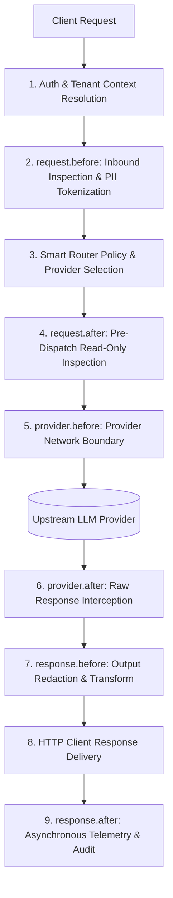

# Execution Hooks Pipeline

Naagmani OS provides deterministic hook interception points across the complete request and response lifecycle:

---

## Supported Lifecycle Hooks

| Hook Name | Execution Phase | Can Mutate Payload? | Common Use Cases |
|---|---|---|---|
| **`request.before`** | After auth, before smart router candidate selection. | **Yes** (Messages, model, parameters) | Semantic routing, RAG context enrichment, PII masking & tokenization, prompt injection defense. |
| **`request.after`** | Immediately prior to provider dispatch. | No (Read-only) | Pre-dispatch audit logging, candidate confirmation. |
| **`provider.before`**| At the provider network boundary. | **Yes** (Provider-formatted request) | Provider header signing, custom rate-limit wrapping. |
| **`provider.after`** | Immediately after upstream provider response. | **Yes** (Raw provider payload) | Upstream error normalization, network latency telemetry. |
| **`response.before`**| Before response delivery to client. | **Yes** (Choices, content, metadata) | Output moderation, toxic content filtering, client placeholder restoration. |
| **`response.after`** | Asynchronous post-delivery phase. | No (Read-only) | Asynchronous token billing, telemetry calculation, compliance archiving. |

---

## Hook Priority & Execution Order

Multiple plugins can attach to the same hook point. They execute strictly ordered by the `priority` integer declared in `plugin.json`.

**Rule**: Lower priority numbers execute **earlier** in the pipeline:
1. `Plugin A` (`priority: 5`) — Executes first (e.g., Auth & Ingress Security)
2. `Plugin B` (`priority: 10`) — Executes second (e.g., PII Redaction / Privacy Shield)
3. `Plugin C` (`priority: 100`) — Executes third (e.g., Default Custom Filters)

Each mutating plugin receives the payload resulting from the preceding plugin in the pipeline. If any plugin with `failure_policy: "fail_close"` returns a block decision or fails, the pipeline terminates immediately.

---

## Decisions

Plugins communicate execution decisions back to the OS:

- **`continue`**: Allow pipeline execution to proceed without modification.
- **`modify`**: Provide replacement request or response payloads.
- **`block`**: Immediately terminate the request with HTTP 403 Forbidden and a specified block reason.

---

## Related Documentation

- [Plugin Manifest Specification](/build/hdks/manifest)
- [Plugin Lifecycle & Sandboxing](/build/hdks/lifecycle)
- [Building Plugins with HDK](/build/hdks/development)
