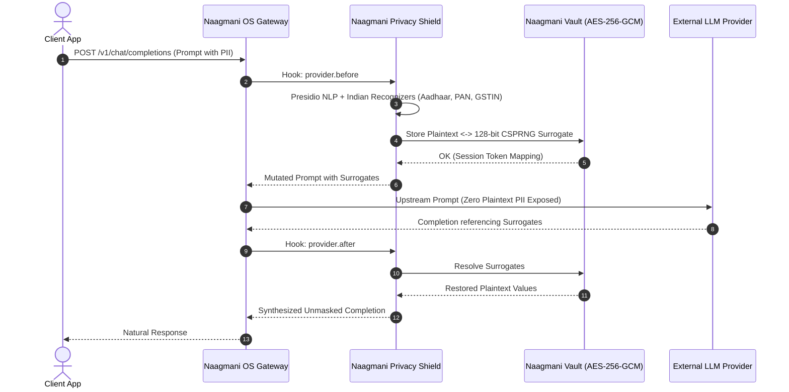

# Naagmani Privacy Shield v1.0.0

The **Naagmani Privacy Shield** is an enterprise-grade AI privacy boundary plugin engineered to detect, tokenize, and redact Personally Identifiable Information (PII), Indian national identifiers, and cloud credentials before prompts are transmitted to external LLM providers (e.g. OpenAI, Anthropic, Bedrock).

- **Category**: Plugin (`Security & Privacy`)
- **Entitlement Tier**: Enterprise
- **Certification**: Certified by Naagmani Security Team
- **Digest**: `sha256:d8b2e5a407e3240e59c63673dc2d26f63c873ad92a6c2f354780512809489f68`
- **Signing Algorithm**: Ed25519 (Key ID: `naagmani-official-root-key-2026`)
- **License**: Apache-2.0
- **Runtime**: Python (`naagmani.plugin/v1`)

---

## Architectural Flow



---

## Supported Detection Categories

| Entity Category | Recognizer Implementation | Validation Logic |
| :--- | :--- | :--- |
| **Aadhaar Number** | Custom `IndianAadhaarRecognizer` | Verhoeff 12-digit mathematical checksum |
| **PAN Card** | Custom `IndianPanRecognizer` | 10-character Indian Income Tax alphanumeric format |
| **GSTIN** | Custom `IndianGstinRecognizer` | 15-character State-coded GST format |
| **UPI ID / VPA** | Custom `IndianUpiRecognizer` | Handle + bank prefix syntax pattern |
| **IFSC Code** | Custom `IndianIfscRecognizer` | RBI 11-character bank branch alphanumeric pattern |
| **API Keys & Secrets**| Custom `ApiKeyRecognizer` | High-entropy cloud credentials (AWS, OpenAI, GitHub) |
| **Email Address** | Presidio Analyzer | RFC 5322 regex + NLP context score |
| **Phone Number** | Presidio Analyzer | E.164 international & 10-digit Indian formats |
| **Credit Card** | Presidio Analyzer | Luhn algorithm validation (Visa, MC, Amex, RuPay) |
| **US SSN** | Presidio Analyzer | 9-digit US Social Security number validation |

---

## Intercept Hooks & Security Boundaries

- **`provider.before`**: Intercepts requests immediately before provider inference. Inspects prompt text and parameters, generates 128-bit CSPRNG surrogate placeholders (e.g., `[AADHAAR_a8b9c1d2]`), and rewrites the prompt.
- **`provider.after`**: Intercepts model completions. Unmasks tokenized surrogates so end users receive original values seamlessly.
- **Failure Policy**: Configured to **`fail_close`**. If tokenization takes longer than 1500ms or fails, the AI request is safely rejected with an error rather than sending unmasked data to the LLM.

---

## Configuration Schema

Configured per project environment via the Developer Portal or Naagmani CLI:

```json
{
  "confidence_threshold": 0.6,
  "default_action": "TOKENIZE",
  "inspect_response_pii": false,
  "mapping_ttl_seconds": 3600,
  "strict_streaming_no_downgrade": false,
  "action_map": {
    "AADHAAR": "TOKENIZE",
    "PAN": "TOKENIZE",
    "CREDIT_CARD": "MASK"
  },
  "allow_list": ["company.internal.domain"],
  "block_list": []
}
```

---

## Installation via Naagmani CLI

```bash
# Install into a project for the test environment
naagmani plugins install naagmani-privacy-shield --project <project_id> --env test

# Install into production after staging verification
naagmani plugins install naagmani-privacy-shield --project <project_id> --env production
```

---

## Verification via cURL

```bash
curl -X POST https://api.naagmani.ai/v1/chat/completions \
  -H "Authorization: Bearer $NAAGMANI_API_KEY" \
  -H "X-Project-Id: prj_your_project" \
  -H "X-Environment: test" \
  -H "Content-Type: application/json" \
  -d '{
    "model": "gpt-4o",
    "messages": [
      {
        "role": "user",
        "content": "Verify customer Aadhaar 2345 6789 0123 and email user@example.com for onboarding."
      }
    ]
  }'
```
