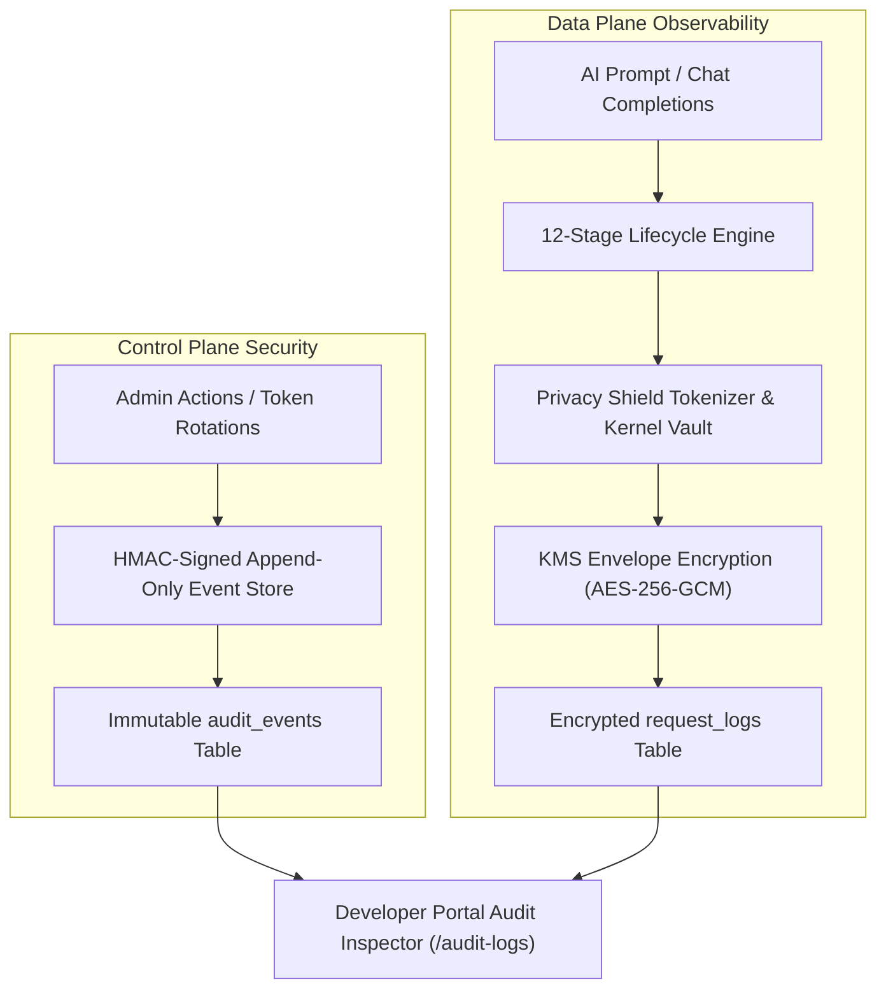

# Security Audit Logs & Compliance Trail

Every critical administrative mutation, credential rotation, and AI inference request lifecycle stage across the Naagmani ecosystem is immutably logged for enterprise compliance audits (**SOC 2 Type II**, **ISO 27001**, **HIPAA**, and **GDPR**).

- **Developer Portal Viewer**: `Organization > Audit Logs` (`/audit-logs`)
- **Operations & Portal Guide**: [Developer Portal Audit Logs & Trace Inspector](/docs/developer-portal/operations/audit-logs)
- **Inference Architecture Deep Dive**: [Inference Payload Observability Architecture](/docs/security/inference-observability)

---

## 1. Compliance Architecture & Tamper Resistance

Naagmani implements dual audit streams partitioned by architectural tier:



### Tamper-Evidence & Non-Repudiation
- **Append-Only Store**: Audit events are cryptographically recorded with actor email, actor user ID, client IP address, and request user-agent.
- **Before/After State Diffs**: Credential rotations, routing updates, and budget modifications capture before and after state snapshots.
- **Hard Secret Invariant**: API keys, bearer tokens, passwords, and private keys are scrubbed before storage and can never be retrieved in cleartext.

---

## 2. Threat Models & Why Payloads Are Encrypted at Rest

Enterprise compliance frameworks strictly prohibit the casual storage of raw prompts and completions in unencrypted database tables. Even for Organization Owners, Naagmani enforces encryption-at-rest (`encrypted_payload`):

1. **Database Breach Protection**: In the event of a compromised PostgreSQL database replica or backup disk snapshot, payloads are encrypted with AES-256-GCM data encryption keys (DEKs) wrapped by KMS. Data remains mathematically undecryptable without the master key.
2. **Untrusted DBA & Insider Mitigation**: Database administrators running raw SQL queries cannot read proprietary company prompts, employee chats, or end-user customer PII.
3. **Audited Privileged Reveal**: Decrypting payloads requires the caller to hold `audit.payload_reveal` permissions and submit a mandatory business justification. The decryption triggers a high-severity `request_log.payload_reveal` audit record.

---

## 3. Configurable Payload Logging Policies

Organizations choose their logging posture based on regulatory requirements:

| Policy | Data at Rest | Developer Portal Access | Best For |
| :--- | :--- | :--- | :--- |
| `metadata_only` | No bodies stored (`null`) | Execution traces and token metrics only | Production / Strict HIPAA / GDPR |
| `redacted_payload` | Stored as sanitized plaintext | Direct inspection without reveal prompt | Development & Internal Testing |
| `encrypted_payload` | Stored as AES-256-GCM ciphertext | Audited reveal with mandatory justification | Regulated Production / Enterprise Forensics |

To update an organization's logging policy:
```bash
curl -X PUT "https://api.naagmani.com/v1/organizations/{orgID}/retention" \
  -H "Authorization: Bearer <ADMIN_OR_OWNER_TOKEN>" \
  -H "Content-Type: application/json" \
  -d '{
    "payload_logging_policy": "encrypted_payload",
    "retention_days": 90
  }'
```

---

## 4. Related Guides

- [Developer Portal Audit Logs & Trace Inspector](/docs/developer-portal/operations/audit-logs)
- [Inference Payload Observability Architecture](/docs/security/inference-observability)
- [Roles, Scopes & Access Control (RBAC)](/docs/developer-portal/organization/roles)
- [AI Guardrails & Privacy Shield](/docs/developer-portal/governance-routing/guardrails)
