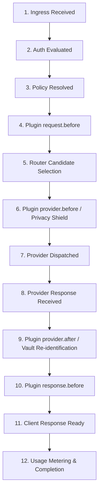

# Inference Payload Observability & Plugin Execution Trace

Naagmani provides enterprise-grade inference request lifecycle observability across Naagmani OS, Cloud, and the Developer Portal. This architecture enables authorized Organization Owners and Auditors to inspect execution traces and plugin transformations without weakening production Privacy Shield invariants or exposing plaintext secrets.

---

## 1. Core Architecture & Philosophy

In modern enterprise AI systems, debugging prompt transformations, privacy sanitization, and routing decisions requires full lifecycle visibility. However, logging raw prompts and responses by default introduces substantial compliance, privacy, and data-leak risks.

Naagmani resolves this tension via:
1. **Configurable Capture Policies**: Strict hierarchical configuration (`metadata_only`, `redacted_payload`, and `encrypted_payload`).
2. **KMS Envelope Encryption**: When payload storage is enabled, sensitive snapshots are encrypted using AES-256-GCM data encryption keys (DEKs) wrapped by an authoritative Key Management Service (AWS KMS or Local KMS).
3. **Audited Privileged Access**: Organization Owners cannot view plaintext payloads casually. Viewing decrypted payloads requires explicit justification, permission validation (`audit.payload_reveal`), and writes an immutable audit record.
4. **Hard Secret Scrubbing Invariant**: API keys, Bearer tokens, cookies, passwords, private signing keys, and Vault keys are **NEVER** logged in plaintext under any policy or reveal mode.

---

## 2. Supported Logging Policies

| Policy | Description | Storage State | Permitted Use Cases | Default |
| :--- | :--- | :--- | :--- | :--- |
| `metadata_only` | Captures timing, token counts, routing choices, and 12-stage execution traces. Payloads are excluded. | Empty (`null`) | Production environments, strict HIPAA / GDPR compliance. | **Yes** (Default) |
| `redacted_payload` | Captures request and response snapshots with PII placeholders, credentials, and API keys redacted. Bounded at 64KB. | Redacted plaintext | Development, staging, non-production debugging. | No |
| `encrypted_payload` | Envelope-encrypts all payload snapshots and transformation diffs with AES-256-GCM. | Ciphertext (`enc:v1:...`) | Enterprise compliance audit, regulated debugging. | No |

### Policy Precedence Hierarchy

A project or client request can **never** override a stricter organization or platform restriction:

$$\text{Effective Policy} = \min(\text{Platform Max}, \text{Organization Policy}, \text{Project Preference})$$

Where `metadata_only` > `redacted_payload` > `encrypted_payload` in terms of strictness.
In `production` environments, the platform defaults to `metadata_only` unless explicitly configured and permitted by platform governance.

---

## 3. The 12-Stage Inference Execution Lifecycle

Naagmani OS instruments every inference request at authentic runtime boundaries across 12 sequential stages:

1. **`ingress_received`**: Client HTTP request received at the OS ingress gateway.
2. **`auth_evaluated`**: Authentication evaluated (API Key or Project Service Token) and scopes verified.
3. **`policy_resolved`**: Effective payload logging policy computed across platform, organization, and environment constraints.
4. **`plugin_request_before`**: Pre-routing plugin hooks evaluated (e.g. rate limiters, early guardrails).
5. **`router_candidate_selected`**: Smart Router evaluates candidate targets, health latency, and failover policy.
6. **`plugin_provider_before`**: Provider boundary hooks executed. Privacy Shield performs PII entity detection and tokenization (`9876543210` $\rightarrow$ `[PHONE_1]`). Mappings stored in Kernel Vault.
7. **`provider_dispatched`**: Sanitized payload dispatched to external AI model provider (OpenAI, Anthropic, Gemini, etc.).
8. **`provider_response_received`**: Raw provider completion response received at the security boundary.
9. **`plugin_provider_after`**: Authorized token placeholders re-identified from Kernel Vault for verified destinations.
10. **`plugin_response_before`**: Post-provider response transformation hooks executed.
11. **`client_response_ready`**: Final sanitized response serialized for delivery to calling client application.
12. **`metering_completed`**: Token consumption, FinOps budgets, and duration recorded.

---

## 4. Multi-Boundary Payload Visibility

Observability distinguishes five distinct payload boundaries:

1. **Incoming Request**: The original prompt received from the client application.
2. **Plugin Transformations**: Step-by-step diffs showing which fields were modified by each plugin (e.g. `messages[0].content`).
3. **Provider Request**: The exact sanitized payload sent to the external provider (containing opaque placeholders like `[PHONE_1]`).
4. **Provider Response**: The raw response generated by the external model provider before post-provider processing.
5. **Final Client Response**: The response delivered to the client with authorized vault re-identifications applied.

---

## 5. Granular Permissions & Access Control

| Permission Key | Resource | Action | Description |
| :--- | :--- | :--- | :--- |
| `audit.read` | `audit` | `read` | View organization audit trail, request metadata, and status codes. |
| `audit.payload_read` | `audit` | `read` | View redacted request and response snapshots in request logs. |
| `audit.trace_read` | `audit` | `read` | View 12-stage execution timelines and plugin transformation diffs. |
| `audit.payload_reveal` | `audit` | `reveal` | Perform audited privileged decryption of encrypted payload snapshots. |
| `audit.manage` | `audit` | `manage` | Configure retention period (7 to 365 days) and logging policies. |

---

## 6. Privileged Reveal Protocol

When a log record is stored under `encrypted_payload`:

1. An authorized user with `audit.payload_reveal` initiates a reveal request.
2. The user **must** submit a non-empty `reason` (e.g., `"Investigating tokenization anomaly in ticket #5821"`).
3. The Cloud API calls the OS Daemon endpoint:
   `POST /v1/request-logs/{id}/reveal`
4. The OS Daemon retrieves the encrypted envelope, verifies the Additional Authenticated Data (AAD) containing `orgID:projectID:envID:requestID`, and invokes KMS to decrypt the Data Encryption Key (DEK).
5. The payload is decrypted in-memory, passed through `ScrubHardSecrets` to guarantee no authorization credentials leak, and returned over TLS.
6. The Cloud API immutably writes an event to the Organization Audit Trail:
   - **Event**: `security`
   - **Action**: `request_log.payload_reveal`
   - **Actor**: User ID / Email
   - **Metadata**: `{ "log_id": id, "reason": reason, "revealed_by": email }`

---

## 7. Developer Portal UI Walkthrough

For an interactive, step-by-step tutorial on navigating the 12-stage execution timeline, inspecting plugin diff badges, and executing the Privileged Reveal protocol in the UI, refer to:

👉 **[Developer Portal: Security Audit Logs & Inference Trace Observability](/docs/developer-portal/operations/audit-logs)**

